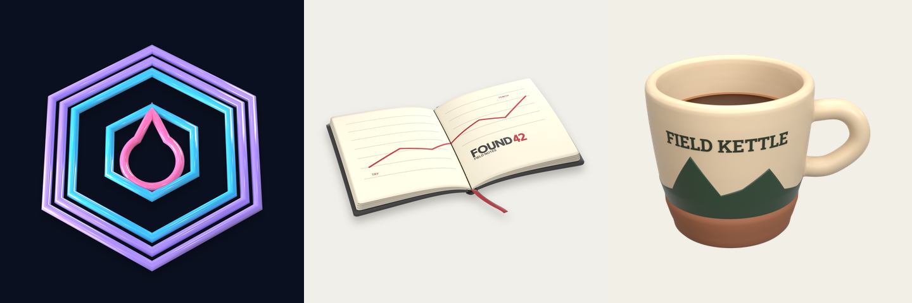

# logo-maker

**From a brief to a logo—and the files to use it.**

Turn a brief, an existing logo, or a repository into flat brand assets and rendered 3D designs.
Work with your coding agent or the CLI; keep the vectors, geometry, and editable scenes.
**No AI image generation:** the agent authors the design, renderers make the pixels, and
[Jev](https://docs.typesafe.ai) can judge the results.



*Actual logo-maker output: a geometric identity, a modeled notebook, and a branded mug.
These are rendered examples, not photographs.*

[**Get started →**](#get-started) · [Flat assets, no GPU](#just-need-a-logo-or-favicon) ·
[3D study guide](skills/logo-maker/references/studies.md) · [MIT license](LICENSE)

## From a mark to the whole set

- **For your app:** SVG marks, favicons, avatars, and PWA icons.
- **For your brand:** explore distinct directions, compare renders, and refine the one that fits.
- **For your next revision:** keep editable `.blend` scenes and vector artwork, not just a PNG.
- **For your agent:** use the skill and MCP tools in Claude Code, Codex, or omp.

Start with your project's name, audience, and intended use. An agent writes the brief and
concepts; logo-maker builds, renders, and packages them. Studies let you compare named designs.
The judged pipeline adds brief review, visual QA, and head-to-head selection.

![Seedwell study: 3D hero, flat mark, monochrome, and compact icon.][seedwell-sheet]

[seedwell-sheet]: docs/assets/readme/seedwell-contact-sheet.png

*One identity across a 3D hero, a flat mark, monochrome artwork, and a small icon.
This contact sheet is from a real study delivery.*

Depending on the workflow, deliverables include:

| Use | Files |
| --- | --- |
| Launch page and social | Transparent hero PNG, hero on a background, avatar |
| Website and app | Color and monochrome SVG, PNG favicons, `.ico`, PWA icons |
| Keep designing | Editable Blender `.blend`, with `.glb` in the judged export workflow |
| Review and handoff | Contact sheets; study ZIPs or an export manifest |

See the [export specifications](docs/render-export.md) for exact sizes and workflow differences.

## Get started

Install [uv](https://docs.astral.sh/uv/getting-started/installation/), then clone the project:

```sh
git clone https://github.com/nicolas-found42/logo-maker.git
cd logo-maker
```

### Try a flat export—no GPU or API key

Turn the bundled Seedwell vector artwork into four favicon sizes without installing the 3D stack:

```sh
uv run --no-project --python 3.13 \
  --with drawsvg --with skia-pathops --with resvg-py --with pillow \
  --with fonttools --with httpx --with vtracer python - <<'PY'
from pathlib import Path
from logo_maker.motif import rasterize

out = Path("demo-output")
out.mkdir(exist_ok=True)
for size in (16, 32, 180, 512):
    rasterize(Path("docs/assets/readme/seedwell.svg"), size, out / f"favicon-{size}.png")
print(f"Open {out.resolve() / 'favicon-512.png'}")
PY
```

Open `demo-output/favicon-512.png` to see the result. This exports existing artwork; to design
your own mark or resize your own SVG, follow the [flat-assets recipe](skills/logo-maker/references/flat-assets.md).

### Set up 3D on your Mac

**Full 3D rendering requires Apple silicon macOS with a Metal GPU.**
Install [Homebrew](https://brew.sh), Node 24, and
[just](https://just.systems/man/en/packages.html), then run from this checkout:

```sh
just setup
uv run --locked logo-maker doctor
```

Setup installs the rendering and artwork tools and warms the Metal kernels. The first kernel
compile can be silent for **1.5–5 minutes**; let it finish.

**No API key yet?** You can render and package 3D studies without one. Doctor will flag the
missing key; Jev review and the judged pipeline need `OPENROUTER_API_KEY` or `TYPESAFE_API_KEY`.
See [setup and troubleshooting](skills/logo-maker/references/setup.md).

### Connect your agent

From this checkout, install the skill and MCP server for your host:

```sh
uv run --locked python scripts/install.py --agent claude
```

Replace `claude` with `omp` for omp. For a project-scoped Codex install:

```sh
uv run --locked python scripts/install.py --agent codex --destination /absolute/project
```

Refresh or restart your agent host, then try a concrete brief:

> Use logo-maker to create an identity for Trailnote, a hiking journal app.
> It should feel warm, capable, and easy to recognize at favicon size.
> Start with three distinct flat directions and show them at small sizes.
> After I choose one, make a 3D study and package the editable scene and web assets.

The agent handles the authored files and tool calls. This is an iterative design workflow,
not a one-command image generator.

### Prefer the CLI?

```sh
uv run --locked logo-maker new trailnote --name "Trailnote"
uv run --locked logo-maker study trailnote --concept cairn --concept trail --preview
```

The preview command first stops for you or your agent to author the named concepts and scenes.
Follow the [3D study walkthrough](skills/logo-maker/references/studies.md), then rerun it to
compare your designs. Render and package the selected concept with:

```sh
uv run --locked logo-maker study trailnote --concept cairn
```

Keep the returned study ID to [review that exact delivery](skills/logo-maker/references/studies.md#render-inspect-and-deliver).

## Just need a logo or favicon?

Skip the 3D stack. The [flat-assets recipe](skills/logo-maker/references/flat-assets.md) creates or
reuses SVG artwork, checks the silhouette at small sizes, and exports PNG favicons and `.ico`.
The [minimal Python setup](skills/logo-maker/references/setup.md#when-a-working-checkout-is-missing)
skips Blender dependencies, Node packages, and GPU warm-up. No Jev key required.

## Go deeper

- [Agent skill](skills/logo-maker/SKILL.md) — briefing, authoring, inspection, and delivery.
- [3D studies](skills/logo-maker/references/studies.md) — compare and package selected designs.
- [Branding campaigns in Codex](skills/logo-maker/references/campaign.md) — persistent modeled
  projects with approval, budget, and render state; requires the documented Metal preflight.
- [Architecture](docs/architecture.md) — resumable stages and file contracts.
- [Rendering and exports](docs/render-export.md) — renderers, pixel QA, and deliverables.
- [Adapters and licenses](docs/adapters.md) — external tools and their requirements.
- [Jev questions](docs/jev-questions.md) — what the model judges and how code uses its answers.

**Current scope:** early-stage software. Study delivery is not the same as production
qualification; review and qualification states remain explicit. The verified 3D target is
Apple silicon macOS, not Windows, Linux, or Intel Macs.

## License

[MIT](LICENSE). Dependencies retain their own licenses;
see [third-party notices](THIRD_PARTY_NOTICES.md).
