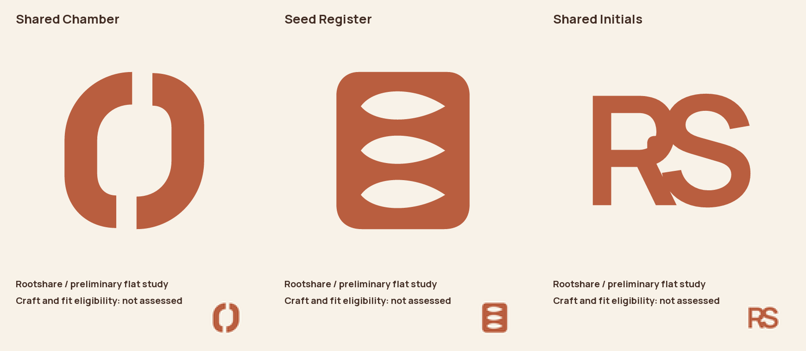
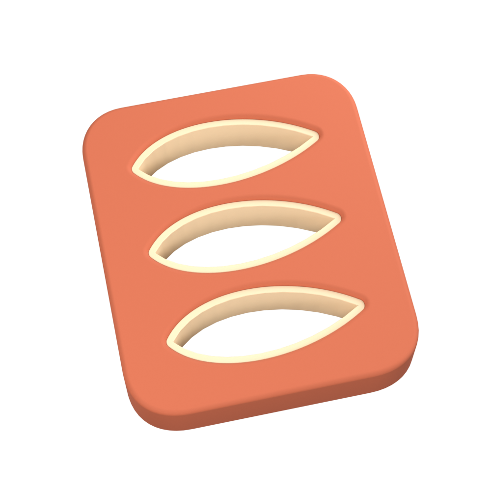

# Brief workflow and image checkpoint — not qualified

Observed November 10, 2026, in the uncommitted follow-up to `37af04f`. This archive retains
both successful process checks and failed image calibration. It establishes neither improved
logo quality nor completion of issue #2.

## Current brief controls

The five predeclared cases were rerun through `pipeline.review_brief` with the current
source-scoped review protocol, in a new directory. Exact requests and answers are retained.

| Case | Observed result | Frozen requirements |
| --- | --- | --- |
| Owner red mandate preserved | Pass | Written |
| Owner mandate omitted | Fail, source coverage .02 | Absent |
| Owner mandate recast as a proposal | Fail, source coverage .02 | Absent |
| Material deliberately open | Pass, source coverage .72 | Written |
| Unsupported free home pickup claim | Fail, grounding .11 | Absent |

These probabilities are observations, not test assertions or new thresholds. Earlier unsettled
and incorrectly permissive diagnostic results remain in their original archives/local records.
The corrected source state excludes proposals from evidence that an owner mandate was retained.
No repeated-call voting or favorable-answer selection is used.

Recipe: `recipes/brief_controls.py.txt`, with its `ROOT` set to a new directory before running
under `uv run --locked python`. The current run is `brief-controls-checkpoint/results.json`.
Do not overwrite a previous experiment or reuse its frozen files.

## Rootshare development

The more specific brief has a passing freeze and three passing concept/detail plans. Sources
separate fixture facts, owner correction obligations and project constraints. No return cycle,
tracking system or required R is invented. Actual flat studies explore complementary shared
space, a seed collection and a name-led construction. They are development alternatives, not
eligible finalists or an owner-selected direction.

Flat-study metadata retains the earlier requirements revision under which the studies were
authored. Later protocol/freeze revisions and rebound plans remain in the history. These are
historical records; do not rewrite them to imply they were authored under the latest revision.

Seed Register was selected for bounded development only. Its shared motif supplies the ceramic
body and three recessed pale collars; construction checks report watertight meshes. That is
geometry evidence, not evidence of good design. The first actual preview remains **unsettled**
against both Chief references in both presentation orders, with several fit/technical/detail
judgments also unsettled. No finalist, winner, export or owner approval is claimed.

The first preview and its authored inputs, execution evidence and assessment were preserved
before a one-variable surface probe. The probe changes `bump_scale` from 150 to 50, retaining
geometry, lighting, camera and 256-sample preview settings. Its delivered image hash begins
`92a250fc`. Actual execution verification reports Metal tracing, CPU tracing disabled and
OIDN 2.5.0 RT filters executed on Metal. Required CPU host work remains allowed. Neither the
sampling limit nor convergence is established by that evidence.

Parent visual inspection found a subtle surface difference without a clear improvement to the
generic plate/container silhouette. This is an author review observation, not an owner label,
audience finding or second eligibility assessment. No fresh final has been made or reviewed.
The proposed next step is an encounter/name/flat-direction checkpoint before further finish.

## Chief diagnosis and live test failure

`opaque-chief-probe/results.json` retains twelve diagnostic requests. Compositing images over
RGB(240,240,240) did not settle cross-treatment comparisons: status maps stayed identical to
the transparent counterparts. Rejected Rootshare controls also failed to qualify. This did not
justify a production transport or rubric change. The recipe and source/derived hashes are kept;
duplicate whole opaque images/native crops can be regenerated. Actual sent pixel assets remain.

The fresh live suite **failed**: two tests passed, but the original Chief craft self-control
returned unsettled in candidate-first order. `edge_refinement` was .69; reference-first was .74.
The exact candidate/reference whole-image hashes, native-detail hashes and intended appearances
match within each self-comparison. No threshold was lowered and no favorable retry replaced it.
The reconstruction self-control and rejected Skill Swap test passed. Historical green live runs
do not supersede this failure. Cross-treatment and original-appearance calibration also remain
unresolved.

## Verification and reproduction limits

Observed commands at this checkpoint:

- `just test`: 317 passed, four deselected; 49 upstream NumPy/skimage deprecation warnings.
- `just lint`: passed after simplifying a nested conditional in the new payload regression test.
- `just type`: passed.
- `just render-example`: one passed, 320 deselected; GPU regression including SSIM floor.
- `uv run --locked python -m pytest -q -m live --basetemp=logos/issue-2-completion/live-checkpoint`:
  one failed, two passed, 318 deselected, as described above.
- Current Rootshare freeze and all three plans revalidated without provider calls; the second
  preview's execution proof revalidated against its current bytes and inputs.

The manifest hashes every copied file. Request assets are retained by SHA-256; all referenced
sent-image assets were checked present and hash-correct. Original Chief inputs are deduplicated
to existing repository assets listed in `manifest.json`. Rebuildable PLY/Blender/model binaries
are omitted; their authoring recipes and execution manifests remain. Archived `.py.txt` files
must be restored to their original `.py` names for authoring replay.

Frozen records retain original absolute paths and protocol hashes. This archive is evidence,
not a reusable approval cache in another checkout. A relocated reproduction must reconstruct
inputs and obtain new brief/plan/eligibility reviews; it cannot inherit the recorded passes.
The bootstrap plan recipe predates custom geometry: do not rerun it over developed artwork.

Required remaining evidence includes resolved calibration, eligible actual finals, fresh exact
owner review, an untouched different-material success, final checks/CI and whole-issue review.
No research judgment, green offline suite or GPU attestation supplies those missing outcomes.
