# Architecture

Codex branding campaigns follow [the campaign contract](campaigns.md) and
[ADR 0002](adr/0002-codex-brand-campaigns.md). This adds packed-scene qualification
without changing the existing declarative profile scope.

logo-maker turns a brief into a judged, rendered 3D logo and an export set. Three actors share the
work:

- **The agent** (guided by `skills/logo-maker/SKILL.md`) writes the brief, drafts metaphors, and
  authors a motif and a scene for each shortlisted concept.
- **Jev** (TypeSafe's System One model) answers typed questions about text and images.
  A Noul is a probability in `[0, 1]`. Code turns the answers into actions through truth tables.
- **The tool** does everything else: builds the concept pool, runs the judging chain, renders, runs
  the QA loop, exports, and logs.

No stage generates images with an AI model. Every pixel comes from geometry, fonts, materials, and
renderers.

## Entry points

| Workflow | Entry point | Prerequisites and governing records | Delivery gate |
| --- | --- | --- | --- |
| Judged declarative 3D | `new`, then `run` or the individual stages | Reviewed brief and plans, authored motifs and recipes, Jev access and verified Cycles Metal/OIDN. `run.json` tracks orchestration and receipts bind stage evidence. | Current creative, visual and sampling proof for the winner |
| Standalone 3D study | `study`, optionally `review-study` | Brief, named concepts, motif and scene inputs, Apple Silicon and verified Cycles Metal/OIDN. The study manifest and review receipt govern the artwork. Jev is optional. | Verified study assets, with visual findings and owner acceptance recorded separately |
| Modeled Codex campaign | `campaign` / `logo_campaign` | Approved research brief and directions, selected preview, pinned Apple Silicon runtime. `campaign.json` records limits, decisions and revisions. | Review handoffs can precede production qualification. Qualified delivery requires current scoped evidence and campaign acceptance. |
| Flat or typographic Codex campaign | `campaign` with a flat or typographic brief | Approved brief and directions, verified preview archive and selected concepts. | Exact preview archive acceptance and verified files |
| Standalone flat assets | [Flat workflow in the skill](../skills/logo-maker/SKILL.md) | Authored vector art and the 2D tools required by the recipe | Checks in the flat recipe and the user's decision |

`doctor` reports installation-wide health. A failing tool check matters to the workflows that
use that tool. A green check establishes installation health within the scope of the check.

## Judged declarative pipeline

```mermaid
flowchart LR
  brief[brief: evidence review + freeze] --> intake[intake: references + palette/fonts]
  intake --> ideate[ideate: pool -> screen -> score -> tournament -> top 8]
  ideate --> author[agent authors plan + construction intent + motif]
  author --> plan[plan: intent + detail review]
  plan --> motifs[motifs: derive geometry + tune starter scene]
  motifs --> refine[refine: retain preview image, inspect, judge, revise, compare]
  refine --> preview[preview: craft + creative gates, pick finalists]
  preview --> finalize[finalize: 4000 px adaptive, diagnosis, final tournament]
  finalize --> export[export set]
  export --> improve[improve: new round must beat the floor]
```



| Stage | Command | Reads | Writes |
|---|---|---|---|
| scaffold | `new` | name and target | starter brief, evidence, metaphors and proposals, version log |
| brief | `brief` | project/owner evidence, `brief.toml`, `brief-evidence.toml`, reference roles/hashes | `ideation/requirements.json`, `qa/brief-reviews.jsonl` |
| intake | `intake` | current frozen brief, references, proposals | `ideation/intake.json`, palette/fonts |
| ideate | `ideate` | brief, `ideation/metaphors.toml`, catalog | `ideation/pool.jsonl`, `stage1.jsonl`, `stage2.jsonl`, `tournament.jsonl`, `shortlist.json`, `concepts/<slug>/concept.json` |
| plan | `plan` | current requirements, `concept.json`, `plan.toml` | `plan-review.json`, `qa/plan-reviews.jsonl` |
| author motifs | (agent) | `concept.json` | `concepts/<slug>/motif.py` or `motif.svg` |
| motifs | `motifs` | motif sources | `motif.svg`, `motif.json`, `motif-sizes.png`; starter `scene.toml` once (layer-aware, one material per motif role) |
| author scenes | (agent) | starter `scene.toml` | tuned `scene.toml`, optional `scene.py` |
| refine | `refine` | reviewed plan, construction, motif, scene, inspection | retained preview renders, judgments and comparisons |
| status | `status` | ledgers and receipts | separate counts and study overview paths in the response |
| preview | `preview` | refinement prerequisites and craft references | `preview.png`, `scene.blend`, `model.glb`, `ideation/finalists.json` |
| finalize | `finalize` | finalists | `final.png`, `scene.blend`, `model.glb`, `qa/rounds.jsonl`, `ideation/winner.json` |
| export | `export` | winner | `exports/*` |

`refine` and `preview` check for a current plan review and construction intent before
deriving the motif or preparing a starter scene. Direct `motifs` can prepare geometry
independently of that rendering guard. `preview` runs refinement and selects finalists from
the resulting images.

Plan and motif work retain their own receipts. Refinement retains active render state and
revision evidence, and marks downstream run stages stale when it captures a new revision.
`status` reports these records. `run` chains stages and stops for required agent authoring.
Resumption checks the current brief, intake inputs and ideation inputs in addition to stage status.

## Owner-selected 3D studies

The study workflow (`study` / `logo_study`, `review-study` / `logo_review_study`) runs locally
on Apple Silicon with Cycles Metal and GPU Open Image Denoise.
The agent can author concepts from a plain-language brief, render the named concepts together,
show a contact sheet, and package the designs the user selects. This path can start with no
provider credentials. It uses the brief and authored concepts directly. It records unavailable
or incomplete Jev evidence and keeps the qualified winner workflow independent.

A concept uses the usual motif and scene recipe. For bespoke construction the agent can author a
self-contained `source.blend` and use the motif for flat assets. The packed scene takes
precedence over a recipe. Custom `bpy` construction in a study requires a packed scene.
The worker opens that scene with automatic
script execution disabled and rejects linked libraries and unpacked external data. It packages
the saved editable scene used for the hero, and records the source and output digests with the
verified GPU execution. A failed proof or interrupted render cannot replace a delivered study.
Compiled studies retain a recipe digest, source artwork and adapter provenance alongside the
packed scene.

Standalone heroes and sampling comparisons render at 2000 px with a 768-sample cap, a 0.008
adaptive threshold and a 64-sample minimum before any comparison overrides. Previews and
the four generated inspection views render at 768 px with an 80-sample cap, a 0.04 threshold
and a 16-sample minimum. The study worker applies these controls after loading its scene.
Campaign studies use the [campaign controls and named cameras](campaigns.md#rendering-and-repairs).

Each selected design has a transparent hero, editable Blender scene, color and mono full-size
marks, flat PNGs, a compact SVG, favicon sizes, a contact sheet and views for inspecting construction.
`compact.svg`, when present, is an optical variant of the shared motif. It supplies the favicon
silhouette while the full artwork remains the flat master. Optional `mono.svg` preserves an
authored one-ink version with intentional negative space. Per-concept photos carry source
URLs, coverage notes and hashes. Photos inherited from the brief carry their role, note and
digest. Use the research role to retain supplementary photos outside the
paired Jev review. The compact review sheet shows 16 px and 32 px on light and dark
surfaces. An optional `compact-dark.svg` provides the dark-surface variant and corresponding
favicons. A concept can override the shared brief's intended appearance for its own construction.
Additional matched camera views and close-ups are included as review evidence when the agent
authors them. Related-object photographs support a craft comparison.
Exact-object claims require corresponding reference evidence.

Study manifests bind delivered files and review inputs to their bytes. Review uses the archived
hero, actual compact icon, brief and photos, with craft, brand fit and technical outcomes recorded
independently. An authored craft or holdout photo can select a verified render view and normalized
photo and render regions for one aspect of finish. Review first checks that both regions show
the comparable feature, then checks execution in both image orders. It retains both judgments,
the original image hashes and the crop hashes. Other photos can still use the general craft floor.
For an adaptation with a supplied `identity.png` and `identity_note`, fit checks preservation
and the requested treatment against that source artwork. Concepts without an identity source
use the original-mark fit checks. Owner acceptance attaches to
the exact study and retains failed and pending findings. Review receipts update separately
from the immutable study ZIP. Review reuse binds the question code, review implementation and
judge identity. Provider errors remain pending. A sampling comparison can render a second seed
with the same settings and report timing and per-region variation. Local calibration renders a stricter
adaptive threshold with the hero's seed and cap held fixed. Qualification still requires the
reviewed evidence and scope described in the sampling contract.

`status` lists study overviews, archives and review receipts. A missing or duplicate holdout is
visible in the study evidence. When a holdout's bytes match a development photo, the development
record takes precedence. An authored matched photo and render can be inspected alongside
the generated survey. Owner decisions bind to the delivered hero and whole manifest.

## Codex campaign execution and release evidence

The [campaign contract](campaigns.md) governs the research, approval, authoring and delivery
workflow. A campaign chooses its medium from the researched brief. Modeled campaigns require
Apple Silicon and a project-local pinned Codex runtime. Native operations use the same launcher
from CLI and MCP. The launcher checks the installed runtime bytes and applies a Codex workspace
profile before running the operation. The worker verifies workspace writes, outside write and
network denials, and child inheritance. The offline render profile must prove a real Cycles Metal
and GPU OIDN render before it can open authored scenes or run a construction generator. The
worker denies access to installed Blender application bundles and checks GPU visibility before
importing the pinned `bpy` module. Reference acquisition and Jev calls use
separate restricted network profiles without Metal access. An unavailable runtime or a failed
boundary or GPU check stops the corresponding operation.

Approval records bind the research and brief, proposed directions, rendered preview selection,
and exact final artwork. A brief or direction edit invalidates dependent decisions by digest.
Explicit delegations are recorded with their scope. Modeled production review requires at
least forty distinct captures per design, including development and independent held-out
comparisons for each critical feature. Flat and typographic campaigns use the acceptance
and file-verification gate above. Bounded construction prototypes may
establish feasibility before committing to a modeled direction.

Diagnostic reviews bind the actual views and development crops. Campaign holdout photos
stay outside the study ZIP and contact sheets, and formal campaign review verifies their
digests before sending crops. `check-construction` can retain supplemental scene-bound
measurements. Production qualification
requires a separately validated evaluator and current scoped sampling evidence in addition to
technical and artwork checks. Control packets and delivery archives are verified from their
contents. Campaign acceptance binds the exact campaign study and ZIP digest in `campaign.json`.
Standalone study acceptance is tracked independently.

[Release qualification](campaigns.md#release-evidence) is an installation-level validation
exercise. It requires the exact installed tool and skill, blinded human labels, frozen evaluator
tolerances and three fresh trials with exact-artwork acceptance. Per-campaign delivery evaluates
that campaign's artwork and scoped evidence. The retained
[validation record](research/codex-branding-campaign-validation-20261113.md#stop-point-november-14-2026)
identifies unfinished release trials and evaluator validation.

## Native execution boundaries

| Input or operation | Execution boundary |
| --- | --- |
| Declarative or standalone study `motif.py` | Python subprocess in the concept directory with the calling environment and a timeout. Filesystem and network access follow the caller's operating-system policy. |
| Declarative `scene.py` | Authored Python executes inside the owned Blender worker. It inherits the caller's access. Declare files it reads for freshness. Custom dependencies are outside the qualified declarative profile scope. |
| Standalone packed study | An owned worker opens the scene with script execution disabled. It rejects linked libraries, registered scripts, drivers and the unsupported external or dynamic data documented by the study worker. Host access follows the caller's operating-system policy. |
| Campaign construction, rendering and archive reopen | The pinned Codex launcher grants workspace writes, grants reads subject to explicit denials, disables direct network access and enables Metal. Authored Python and Blender workers inherit that policy. |
| Campaign photo acquisition, Jev and flat preview | Photo acquisition uses the requested HTTPS source domain. Jev uses the restricted OpenRouter profile. Flat preview uses the offline worker. These operations do not enable Metal. |

Every sandboxed campaign launch checks a workspace write, a denied outside write and
direct local network connection, child write denial, and access to installed Blender.
The native worker probes current Metal visibility on each launch. It can reuse the
verified small-render and OIDN preflight for the same runtime, launcher, renderer,
Blender version, OS and binary-cache configuration. The cache stores the proof image
and log. See the [workspace controls](campaigns.md#rendering-and-repairs).

## Logo folder

`logos/<slug>/` (or `--out DIR`), laid out by `logo_maker.paths.LogoDir`:

```text
brief.toml
brief-evidence.toml
inputs/
ideation/
  metaphors.toml, proposals.toml, requirements.json
  intake.json, palette.json, fonts.json, pool.jsonl, shortlist.json
  finalists.json, winner.json
concepts/<slug>/
  concept.json, plan.toml, plan-review.json, construction.json
  motif.py or motif.svg, motif.json, scene.toml
  preview.png, final.png, scene.blend, model.glb, render-state.json
qa/
  jev/requests/, jev/assets/, jev/answers.jsonl
  revisions/, rounds.jsonl, eligibility.jsonl, studies/
studies/<study-id>/
campaign.json         campaign limits, selections and revisions
exports/
run.json              seeds, versions, orchestration, usage and asset licenses
```

Declarative ideation uses IDs of the form `metaphor|treatment|material`, whose folders are
`metaphor--treatment--material`. A study or campaign may use a simple authored ID such as
`plate`.
The CLI and MCP resolve targets through `paths.resolve_logo`. Stage preparation uses
`LogoDir.concept()` to create concept directories. Proof and artifact checks use
`LogoDir.concept_path()` to locate the same directories without creating them.

The CLI's `new` handoff prints shell-quoted follow-up commands that target the created folder,
including when its path contains spaces or shell punctuation.

Entry points: the CLI and the MCP server resolve the target with `logo_maker.paths.resolve_logo`, and
every stage except `new`/`logo_new` first requires that logo's `brief.toml` through
`require_brief`, so a mistyped target creates no folder. CLI errors exit 2. Authoring stops exit 3,
with the `AUTHORING NEEDED` message, progress counts and any available details on stderr.
MCP stage tools return `{"status": "authoring_needed", ...}`
for authoring work, with progress `counts` (or `{"unavailable": <why>}` when a damaged state file
stops `status`); every other `RuntimeError`/`ValueError`/`OSError` becomes an MCP tool error
carrying its message, because the framework hides the text of unexpected exceptions.
Both entry points reject blank output paths. Stage progress printed to stdout is held off the
MCP transport by one process-wide redirect shared by overlapping calls.

## Contracts

### Brief evidence, review and frozen requirements

`brief.toml` remains the downstream brand/appearance record. Its summary describes the business,
not evidence that a proposed symbol is a good solution. `brief-evidence.toml` separately records:

- `sources`: named owner, project or fixture sources, each with a local path and exact excerpt;
- `facts`: named claims, source IDs and `established`, `assumption`, `unknown` or `conflict` status;
- `requirements`: named business, communication, usage and visual constraints, with origin,
  priority and source IDs; an owner mandate is distinct from a designer's proposal;
- `obligations`: source-linked mandatory workflow instructions, separate from identity attributes.
  Supported kinds are `brief` (clarify against a retained baseline brief), `authoring` (develop
  purposeful detail) and `validation` (compare a declared minimum of distinct craft references).
  Unsupported obligations request authoring work rather than being silently ignored;
- a primary communication priority, explicit design latitude and consequential open questions.

The authoring agent reads available project/owner evidence first. It asks only questions whose
answers change the next design decision. Unsupported claims are removed from the factual brief
or marked as assumptions. Optional design choices can remain open; essential unknowns and
contradictions cannot silently pass. No bundled brand supplies defaults or implied constraints.

`logo-maker brief` / MCP `logo_brief` review this evidence through narrow typed questions.
Requirement-support questions include the frozen mandatory, preference, prohibition or open-choice
scope explicitly; an avoided property is not judged as a required positive attribute.
Code validates structure, source excerpts/revisions and references before asking Jev about
fact support, source-to-requirements completeness, activity, audience, communication priority,
grounding and consistency. The completeness question is unconditional: omitting an extracted
mandate cannot suppress its check. A pass
freezes `ideation/requirements.json`: reviewed brief/evidence, source hashes, exact answers,
question revision and requirement revision. No concept rationale is supplied as proof of business
facts. Raw requests, usage and any error remain in the normal QA log.

Source-to-requirements completeness is evaluated independently for every source, including when
no requirement was extracted. It receives that source's kind/excerpt and only requirements linked
to that source with established authority. Designer proposals cannot prove source coverage;
an owner source requires owner-origin records. Named priority values include their explicit scope
meanings. Every source must pass; no average hides a missing instruction or open choice.
Direction-preservation receives business, specified direction, its explicit open choices and the
requirements. Craft-reference notes are excluded from that direction payload: they establish an
execution floor, so their lettering, material or finish cannot become the candidate's mandate.
Style and geometry reference directions remain present. These are separate requests from the
remaining brief checks, using the same
centralized questions and thresholds. Narrow states keep business prose and archival metadata
from supplying accidental evidence for a different judgment. The freeze retains their combined
answers and complete underlying source/input revisions; each exact request remains independently
logged. Missing answers or an error in any request cannot supply a pass.
Review-input hashes include the review protocol and transport implementation, so changes to state
preparation cannot silently reuse judgments produced from a different request representation.

Intake requires this review before palette/font work. Ideation and later public stages require
the current frozen revision, including resumed runs. Changed inputs invalidate it. Reopening an
authored brief requires an explicit revision reason and preserves the previous freeze/history;
it does not overwrite existing exports or an improvement floor.

Each authored concept adds `plan.toml`, bound to its requirement revision. It records the visual
hypothesis separately from facts, requirement IDs, assumptions, and a detail ledger: feature,
purpose, intended scale, physical construction and deletion test. The shared flat master carries
the primary identity; secondary construction and material detail may resolve in the hero.
`logo-maker plan` / MCP `logo_plan` review each shortlisted plan, retaining exact answers and hashes
in `qa/plan-reviews.jsonl` and its current `concepts/<id>/plan-review.json`. Plan review must
complete
before preview rendering. A plan is authoring intent, never evidence
that the rendered pixels achieve it. Final visual eligibility still judges actual pixels.

Brief/plan review has explicit pass, fail, unsettled, missing-evidence and API-error outcomes.
Fail/unsettled/missing evidence returns named authoring work and consequential questions;
malformed answers and provider errors remain exceptions. Unknown optional choices remain
explicit latitude. There is no requirement to invent a differentiator, make a brief longer,
add ornament, or make every business fact pictorially decodable.

Source completeness covers both identity requirements and obligations. Direction-preservation
judges identity requirements only. A brief obligation compares the proposed brief/evidence with
its retained baseline before freezing. An authoring obligation requires a reviewed detail plan
before preview and separate actual-image realization judgments before advancement. A validation
obligation requires the stated number of distinct craft images; normal eligibility checks every
one in both orders. These obligations stay mandatory at their deadlines; recording one does not
establish that its later outcome has already been achieved. Prior-artifact rejection remains in
artifact-bound feedback/history rather than becoming a new brand attribute.

Validation obligations also pin `expected_references`: each has a descriptive label, input path
and exact SHA-256. Every pinned identity must still be present among the supplied craft references;
two unrelated images cannot satisfy a named comparison merely by meeting its count. Authoring
obligations are sent to plan-coverage and actual-pixel fulfillment judgments in addition to generic
detail realization; a self-selected plan cannot erase the specific requested correction.

[Owner feedback and acceptance](#owner-feedback-and-acceptance) defines how reviews bind the artifact and its input revision.

### Motif (2D master)

`concepts/<slug>/motif.svg` owns the flat master and the contours of motif-derived declarative
components. In a study or campaign the packed scene owns the modeled geometry. Authored
`compact.svg`, `compact-dark.svg` and `mono.svg` own their respective variants when supplied.
The actual hero and compact artwork are reviewed for identity consistency. Adaptation
review also uses the supplied identity source and the allowed treatment. See
[ADR 0002](adr/0002-codex-brand-campaigns.md).

- `viewBox="0 0 1000 1000"`, y down. The mark fits inside a centered circle of radius 470.
- Top-level `<path>` elements in absolute coordinates. Empty `<defs>` may be present as
  exporter scaffolding. Bake transforms into coordinates and outline strokes. Root and path
  styling that the geometry compiler cannot reproduce is rejected.
- Each path has a unique `id` and `fill="#RRGGBB"`. The optional `fill-rule` supports
  `nonzero` and `evenodd` and is applied during flattening. Additional attributes
  - `data-role` selects the palette role (`primary`, `secondary`, `accent`, `highlight`, `ink`).
    The derived mono export uses one ink for every role.
  - `data-height`: relief height multiplier for 3D (default `1`).
  - `data-layer`: integer stacking order for layered treatments (default `0`).
- The agent writes `motif.py` (preferred; uses `logo_maker.motif` to place glyphs, shapes, booleans,
  and 2D tool output, then calls `save()`), or writes `motif.svg` directly in this format. When
  `motif.py` exists, `motif.svg` and `motif.json` are its outputs: each run sets the previous ones
  aside, so a run that does not call `save()` fails instead of reusing them, and a failed run puts
  them back unchanged.

`motif.json` is derived by `logo_maker.motif.flatten()`:

```json
{"viewbox": 1000,
 "layers": [{"id": "mark", "fill": "#1E4A7A", "role": "primary", "height": 1.0, "layer": 0,
             "contours": [[[x, y], ...], ...]}]}
```

Contours are closed polylines (curves flattened at 12 steps), overlaps removed with skia-pathops,
holes as separate contours (even-odd fill).

### Scene (3D recipe)

`concepts/<slug>/scene.toml` composes components from the catalog. `logo_maker.scene` validates it;
the Blender builder (`logo_maker/blender/`) runs it inside a `bpy` subprocess. Units: the motif's
1000-unit box maps to 2.0 scene units at the default `[mark].scale = 1.0`. The mark scale
rescales coordinates around the motif center before compilation.

```toml
[meta]
concept = "metaphor|treatment|material"
treatment = "embossed_plate"     # catalog preset this scene started from (informational)
seed = 1234                      # from run.json

[camera]
tilt_deg = 28                    # 0 = straight on
azimuth_deg = 0
sensor_mm = 36
lens_mm = 100
framing = 0.84                   # fraction of the frame the object's bounds fill

[lighting]
rig = "studio_soft"              # catalog/lighting.toml
hdri = "polyhaven:studio_small_09"   # or "none"
hdri_strength = 0.45

[render]
renderer = "cycles"              # only cycles renders; mitsuba | luxcore | three validate but
                                 # render() refuses them (GPU-only policy, see Render)
look = "photoreal"               # photoreal | toon | lineart
glare = 0.0                      # compositor glare mix (0 = off)
dof_fstop = 0.0                  # 0 = no depth of field
exposure = 0.0                   # Cycles display exposure in EV
alpha_cleanup = false

[materials.surface]              # any number of named materials
preset = "porcelain"             # catalog/materials.toml
color = "#F8F6F1"                # overrides the preset's base color

[[components]]
kind = "plate"                   # see catalog/components.md for every kind and its fields
material = "surface"
```

The optional catalog rig `studio_45` aims its main area-light axis at the origin at 45 degrees
to the +Z face normal. It preserves gentle fill and edge lighting; existing rig defaults remain unchanged.

Mesh components can set `smooth = false` to retain planar facet normals on authored folded or
machined assets. The default remains smooth shading; this is a per-concept geometry decision,
not a material or sampling repair. The flag is boolean and participates in compiled dependency keys.
Materials may also declare a finite nonzero three-component `tangent` vector for an explicit
brushing direction. Without it Blender retains its existing tangent behavior. This authored
material orientation is inventoried in the scene and never selected by sampling QA.

A `[materials.<name>]` table accepts only `preset`, `color`, `emission_color`, `tangent` and the
numeric parameters of `catalog/materials.toml`; any other key is a `SceneError` listing the known
ones, so a misspelled parameter cannot silently render as the preset default. Component numbers
must be finite, and `radius`, `major` and `minor` must be positive.

Cycles scenes may author finite `[render].exposure` in Blender's supported -32 to 32 EV range.
The default is 0 EV. Compilation forwards it in both `render.exposure` and `quality.exposure`,
and the native builder sets view exposure before rendering. Nonzero exposure on another backend
is rejected rather than silently ignored. Exposure leaves authored material color values unchanged
and changes display brightness; it does not alter geometry, lights, sampling or material presets.
It participates in the render scope and image dependency keys, invalidating prior image evidence
and sampling-profile matches when changed. It is an authored diagnosis/revision control, never an
automatic generic-edge repair or evidence of craft eligibility.

Component kinds (each documented in `logo_maker/catalog/components.md`): `plate` (outline from a
shape or the motif silhouette, optional irregular edge, bevel), `recess` (pressed or cut area in a
plate), `rim` (torus or raised border), `relief` (motif layers raised or cut), `extrude`
(freestanding motif solid), `inflate` (soft rounded motif via signed distance fields), `layers`
(stacked cut-outs by `data-layer`),
`ring_text` (text set on a circle), `ribbon` (cloth strip, optionally physics-draped), `tube` (motif
centerline as a swept tube), `voxels` (motif rasterized to cubes), `cad` (build123d solid), `mesh`
(imported OBJ/STL/PLY/GLB), `bpy`
(agent-written `scene.py` fallback with a `build(ctx)` function), and `lathe` (an editable
solid mesh revolved around Z from a closed profile or an axis-ended profile for solid caps).

### Render

`logo_maker.render.render(concept_dir, quality)` runs `python -m logo_maker.blender.build` in a
subprocess with the current interpreter and returns a `RenderResult` (png, blend, glb, seconds,
execution). `execution` points to `.build/attempt-<id>/<quality>.execution.json` for the
selected Cycles attempt. Its adjacent `.log` retains native denoiser diagnostics.
The legacy proof path `.build/<quality>.execution.json` is read when there is no sampling sidecar.
Host postprocessing binds the delivered pixels and source files to that evidence.
Alternate renderers currently lack equivalent
verified GPU tracing/denoising and are rejected operationally at the public render boundary.

Declarative render defaults

| quality | resolution | default samples | use |
|---|---|---|---|
| `test` | 256 px | 64 + denoise | regression test |
| `preview` | 1000 px | 256 + denoise | jev preview screen |
| `final` | 4000 px, downsampled to 2000 px | adaptive 0.01, max 4096, denoise | finals and exports |

For declarative rendering and sampling, the bpy process refreshes devices, disables CPU tracing
selections, selects one available Metal device, and forces the Cycles Metal device override.
Before loading bpy, the doctor, profile and render workers check whether the current Apple Silicon
process can obtain a Metal device. A missing device stops the operation with a diagnostic.
Run this check under the same Codex workspace sandbox as the trial.
Before starting a first trial on that host policy, verify a small Cycles render and actual OIDN
Metal execution there. If Cycles' binary archive cache must be disabled, bind that setting to the
render fingerprint and evidence so those results cannot be reused across different settings.
MetalRT stays `AUTO`. GPU denoising is a separate requirement: support/request flags alone do not
prove execution. Each render must retain effective OIDN Metal runtime evidence or fail
operationally;
CPU/hybrid tracing and CPU denoising are never accepted. Normal CPU scene construction,
synchronization,
Metal submission, image analysis and file I/O remain permitted. Execution verification is
independent
of craftsmanship, fidelity, brief fit and aesthetic preference.
First runs compile Metal kernels (1.5-5 min, no output); a builder attempt is limited to 900 s
and the remaining job deadline. Crash retries consume the same attempt and wall-clock budget.
The final row is the comparator. A matching profile can supply different final controls
within its [qualified scope](#bounded-sampling).
Per-render evidence records build, device selections, effective sampling/seed, denoiser evidence and
timing scope for [sampling qualification](#bounded-sampling).
The alternate renderer modules remain available for development, but cannot supply production
eligibility under the GPU-only contract until they have equivalent independent execution evidence.

### Bounded sampling

The sampling policy is a separate technical contract, not a craftsmanship gate. See
[automatic-sampling.md](automatic-sampling.md) for the profile schema and qualification protocol.
`[render]` exposes `adaptive`, `adaptive_threshold`, `min_samples`, `max_samples`, and `seed`.
Explicit values (including false and zero) are retained in compiled `quality.overrides` and never
rewritten by QA. Zero minimum delegates to Cycles; zero threshold means Cycles automatic threshold,
not zero error. `meta.seed` supplies the deterministic seed unless explicitly overridden.

`[sampling]` exposes `profile` (optional JSON path), `diagnosis` (optional JSON path),
`wall_seconds` (default 1800), `attempt_limit` (default 2, maximum 4), and
`diagnostic_bytes` (default 2147483648, maximum 2147483648 per attempt).
The owner-reviewed M5 Pro final profile in `benchmarks/sampling/profiles/apple-m5-pro-final.json`
uses an adaptive threshold of 0.01 and a cap of 8192 samples per pixel. Its approval applies to
those sampling settings. A different cap requires its own qualification evidence.
Its recorded code fingerprint is historical and yields `profile_stale` against the current
checkout. Missing or invalid profiles return `profile_unqualified`, and unsupported
material or custom Python scope returns `profile_out_of_scope`. These states use the
4096 / 0.01 final comparator unless the recipe supplies explicit controls. They leave final
qualification open. See [profile activation](automatic-sampling.md#profile-activation).
A qualified profile matches the actual machine/OS/build/Blender/OIDN library/backend/device,
Python and image/geometry library versions plus the project lockfile,
stage, resolution, render configuration and dependency scope. Owner-reviewed controls and held-out
cases are required. Profile timing distributions exclude seed; image/diagnosis identity includes
seed.
No image result is reused solely on an mtime or a machine timing key. Custom `bpy` components
remain outside profile qualification and image reuse until their arbitrary file dependencies
can be inventoried; direct inspection renders retain an unresolved state.

`sampling.decide` consumes an image-bound diagnosis naming the reviewed diagnostic region
plus that region’s sample statistics. Saturation elsewhere cannot select a cap repair. Generic edge
QA
alone never increases sampling. Verified cap-limited stochastic noise can increase only the cap;
verified below-cap noise can tighten only the threshold. Structural, typography, resolution,
filtering, alpha and denoiser-detail defects return `refinement_needed` for [creative refinement](#creative-refinement).
Missing or uncertain sampling evidence returns `unknown`. Overrides that prevent a proposed repair return
`override_conflict`. Every optional comparison needs remaining attempts and estimated whole-job
cost; otherwise retain the prior artifact and report `attempt_limit` or `time_limit`.

Each attempt uses the `render_verified` boundary. Optional bounded multilayer EXR retains
Combined, noisy image and normalized Debug Sample Count subimages. Summaries decode counts by
multiplying by the cap, report foreground, dark, alpha-boundary and spatial difficult regions, and
retain missing diagnostics as unknown. Summaries are diagnostics, never an automated quality
verdict.
The final passes through the real 4000→2000 Lanczos path and optional alpha cleanup before
publication.
Failed, device-unverified and over-budget attempts preserve prior output. Failure
receipts use a separate `.sampling.failed-<id>.json` when an active published sampling
record exists and the enclosing deadline leaves time for that write. If the deadline is
exhausted, the surfaced error and any retained attempt evidence describe the failure.
`RenderResult.publication` reports committed publication and completed/pending cleanup;
the retained journal identifies backup/quarantine paths when cleanup is pending.
`RenderResult.sampling`
points to a job record with full input/settings/image keys, delivered hash, attempts, total host
wall
time, execution/denoiser evidence and distinct profile/noise/cap/time/memory/device/quality
outcomes.
Cold/kernel state remains unknown unless observed. Calibration and confirmations are part of cost,
not a free prelude. Heavy CPU host stages (compilation and image processing/diagnostics) run
in owned workers, interrupted at the remaining deadline, including startup and cleanup.
Workers may perform required CPU host work. Tracing and denoising use the verified GPU path.
Asset-use records return as typed `RenderResult.assets` and in the sampling sidecar.
An arbitrary `on_asset`
callback conflicts with bounded rendering: its in-process effects cannot be preserved in
a killable worker. Rendering reports that conflict before invoking it. Direct `scene.compile`
still supports callbacks for caller-managed work. Light
orchestration checks the shared deadline between operations. Native render work is interrupted
at the remaining deadline.
Configuration loading and cached-image/dependency validation also run in owned workers.
Profile/control JSON loading and qualification evidence reads use the same owned-worker
deadline. The worker returns effective settings with explicit overrides preserved, the
qualification result, diagnosis and hashes of the control bytes it loaded. A timeout
retains prior output and cannot start a GPU attempt.
Configuration uses the caller's deadline or the default 1800 s bootstrap ceiling until
its settings are known; the scene deadline then includes that elapsed setup time.
`render_many` has no compilation prepass outside those concept budgets. Host-phase timings
and the execution paths of interrupted attempts remain available in the sampling record.
Finalize and the bounded refinement and preview paths share their deadline with the
[Jev transport](#jev-transport) and host operations. Bounded clients must support
budget binding. The budget starts before input and client setup. Bounded CPU image
checks, including alpha, margin, edge and color checks, run in owned `host.run` workers.

Refinement's source/image hashing, construction and frozen brief/plan validation, inspection
retention,
comparison preparation and revision archival run in owned CPU workers under the shared deadline.
A revision is staged under a private name, then its archive and active render-state are published
through the same recoverable journal interface. Interrupted staging cannot become an active
revision. History reads only public numeric revision directories; private archival stages remain
outside revision counts and comparisons.
Refinement returns the exact creative proof admitted during judging. Preview carries those frozen
inspection/judgment hashes forward instead of independently rebinding newer files to an older pass.
Preview selection similarly publishes finalists and run bookkeeping only after craft and creative
bindings are rechecked. Before and after final tournaments, all eligible candidate bindings are
rechecked; export revalidates the exact winner's source/image/inspection/judgment and craft proof.
[Publication and recovery](#publication-and-recovery) describes the final proof checks
and outcomes. Retained custom previews remain inspection-only while their dependency
inventory is unknown.

Finalize shares a budget across candidates/QA, and export shares it when invoked by `run`.
Standalone export starts its own explicit budget and retains the final's sampling provenance in the
export manifest. Unqualified sampling returns an authoring/review stop and cannot advance to winner.
The owned export worker loads and hashes sampling provenance, checks the delivered final
image hash against a private byte snapshot, and builds the hero from that same snapshot.
A concurrent replacement of `final.png` cannot change the bytes after verification.
Pipeline export pins the exact qualified sampling-record hash through currency
validation and into the export worker. A missing/replaced/unqualified snapshot
fails before publication; legacy unattested exports remain low-level inspection only.
A blocked provenance read therefore consumes
the same deadline as image and adapter work, before export publication.
`owned_process.run` bounds adapter workers and their process groups. Its
[termination and cleanup contract](automatic-sampling.md#effective-controls-and-budgets)
covers platform-specific group inspection and reserves time for reaping. The
[CI workflow](../.github/workflows/ci.yml) provisions the lockfile-pinned PWA browser before
the offline tests and sets `PAG_USE_LOCAL_REV=1` during the test run.

### Resource limits

The diagnostic allowance applies to each render attempt. Four attempts at the 2 GiB
ceiling can retain up to 8 GiB of render diagnostics for one concept, plus images,
scenes and logs. Declarative finalization renders one candidate at a time and uses one
job budget. Campaign actions acquire a writer lock per logo folder. Native campaign
actions also serialize GPU use within the same project. Standalone invocations in
other folders can compete for GPU and disk resources.

Preview and final judgments fan out over candidates, craft references, presentation
orders and native-size tiles. Bounded transport uses the caller's deadline. Campaign
budgets also reserve provider attempts before dispatch. Attempts, revisions, caches,
studies and logs accumulate across jobs. The operator owns storage capacity and
retention. Keep active proofs, their referenced attempts and any pending publication
journal together when archiving older work. See [campaign limits](campaigns.md#rendering-and-repairs)
and [sampling budgets](automatic-sampling.md).

### Qualification fixtures

`benchmarks/omp/` is a provenance bundle, never a brand-default source. Its manifest binds each
retained image, flat mark and recipe dependency to a SHA-256, origin and permitted-use note.
Historical CPU-rendered originals, the 256 px renderer golden, the fresh 2000 px reconstruction,
and new GPU replays retain separate identities. Replays do not replace original bytes.
The verifier checks pinned assets and the four independent owner label dimensions and
reports the manifest's known gaps. Its bundle status is `incomplete`. Transfer qualification
is a separate review exercise covering owner-reviewed different-material successes, held-out
briefs and rejected Skill Swap controls. The small SSIM check covers renderer regression.

## Judgment and eligibility

### Visual eligibility

`brief.toml` declares `intended_appearance` and repeatable `[[references]]` with
`use = "craft"`. Each craft reference's `note` describes its intended treatment.
These references demonstrate execution quality only: they do not supply the candidate's
palette, geometry, lettering, material, symbolism or preferred finish. Style and geometry
references retain their separate meanings. No bundled example is an implicit craft floor.

Before preview finalists and again before the final tournament (including a lone survivor),
compare the actual candidate and every craft reference in both presentation orders. Separate
requests judge execution against the reference's demonstrated floor, symbol/concept fit,
intended appearance, and technical image acceptance. The stricter rubric requires controlled
contours/joins, surfaces, details, edge refinement, material construction, proportions, hierarchy
and lighting. Own-brief fit additionally requires a developed brand-specific idea, purposeful
visual synthesis, constraint fidelity and communicative clarity: merely depicting a category
icon is insufficient. Every criterion is essential; appeal cannot compensate for one failure.
Preference ranks only eligible candidates.
Both true and false craft criteria compare execution against the demonstrated reference floor,
including its imperfections. An absolute defect judgment cannot silently replace that relative task.
Equality to the craft floor passes; a forced Choice, appeal, hardware provenance, or tournament
position cannot establish eligibility. Literal concept match and structural technical checks receive
the current `concept.json.description`, the authored `treatment_text` and `material_text` when
present, and the reviewed plan hypothesis. The plan receipt and eligibility revision bind these
inputs. Legacy records without authored treatment or material text use the catalog descriptions.
The original pool remains the source of concept IDs. A missing current description returns
`missing_evidence` before provider calls.
The admitted concept and plan hashes must match the revision before image queries; edits during
context preparation cannot bind old depiction text to new source bytes.
Own-brief fit receives the frozen business context, communication priority and identity
constraints, with the author rationale excluded. A flattering concept cannot rewrite that fit
request. Neither receives the unrelated reference's design. Gloss, reflections and roundness are
assessed relative to the two intended treatments, without a universal preference for either finish.

Small-size judgments receive the actual flat master and the hero reduced to 32 px and enlarged
with nearest-neighbor pixels; secondary hero lettering is not required at favicon size. Images
larger than the provider's whole-image limit additionally supply every native-pixel tile for
craft and technical checks. Separate sequential calls cover each reference/order, literal match,
own-brief fit, and technical detail. `view_sha256` binds derived evidence; the transport retains
the sent bytes.

Every essential Noul uses the named bands in `questions.py`: yes passes, no fails, and
unsettled requires review. Missing inputs produce `missing_evidence`; malformed answers and
provider failures produce `api_error` and remain exceptions. `qa/eligibility.jsonl` retains
per-dimension outcomes, both orders, source-image SHA-256s, brief/concept/recipe revision,
rubric hash and sampling/execution evidence. The transport additionally retains the exact
encoded pixels/model/questions. Render-policy failures are operational errors and never craft
labels. Final eligibility must bind the current pixels and inputs; export rejects stale winner
evidence. Failed selection leaves existing winner, exports and same-brand improvement floor
untouched. `improve` still separately requires beating that brand's previous winner.
If no candidate passes image eligibility, preview and finalize expose the unresolved or failed
checks, the stage image paths, and the eligibility journal in their authoring response. The
journal retains the underlying probabilities and both comparison orders.
Sampling evidence separates noise, resource limits, detail and device execution. The
declarative sampling gate needs a current scoped profile and an eligible attempt with
available sample-count diagnostics. A capped image can advance when it meets that sampling
gate and independently passes full-image technical and visual acceptance. An unknown
sample-count state remains unresolved for declarative final qualification. A generic edge
failure requests diagnosis. [Bounded sampling](#bounded-sampling) owns numeric controls.

### Owner feedback and acceptance

For declarative selection and export, `qa/owner-feedback.json` is optional. Legacy rows
bind the candidate image SHA-256, brief SHA-256 and concept ID. New rows also record
`input_revision_sha256` from `eligibility.owner_review_scope()`. This binds the exact
image, brief, requirements, sources, references, concept, plan, scene and rubric while
excluding the feedback file itself.

| Feedback | Declarative effect |
| --- | --- |
| Absent | The normal visual, creative and sampling gates decide |
| Current overall, craft or fit rejection | Veto, with the model answers retained |
| Current unresolved feedback | A model pass stays unsettled |
| Rejection for unchanged pixels under a stale input scope | A model pass stays unsettled until an explicit overall approval in the current scope |
| Current overall approval | Resolves a stale rejection. All required model and render evidence still applies. |

Unspecified dimensions remain unknown. A change to the feedback file invalidates the
corresponding export proof. Preference remains independent.

Standalone study acceptance is optional and requires a verified study ZIP. The receipt
names the accepted concepts and binds the study manifest, archive digest and hero hashes.
Visual failures and pending results remain in the receipt. Campaign acceptance is required
for qualified delivery. Record it through the [campaign action](campaigns.md#state-and-decisions)
for the exact study and ZIP, or through the flat acceptance action for the exact selected
preview archive. Changed artwork requires a new bound decision.

### Jev transport

All wording and thresholds live in `logo_maker/jev/questions.py`. `logo_maker.jev.client.JevClient`
sends requests to OpenRouter `POST https://openrouter.ai/api/alpha/decisions` (`OPENROUTER_API_KEY`,
model `typesafe/jev-1.14`), or to TypeSafe `POST https://api.typesafe.ai/v1/systemone` when
`TYPESAFE_API_KEY` is set. Requests with images send base64 assets with
`TypeSafe-Danger-Zone-Images: true`. A logo-bound client records requests in `qa/jev/requests/`,
with image hashes and exact sent PNG or JPEG assets in `qa/jev/assets/`.
It appends events to `qa/jev/answers.jsonl`.
HTTP 429, 502, 503, 504 and 529 and transport errors retry with backoff. Other provider
failures raise `JevError`.
Every answer is validated against its question before use: a Noul must be a number in [0, 1], a
Score finite, and a Choice one of the question's options; otherwise the request is an `api_error`
and raises `JevError`. A stored judgment that is reused on resume (stage 1, stage 2, tournament
rows) carries the hash of the exact state and questions it answered.
Provider failures and malformed response envelopes retain the submitted state, questions and
sent-image assets with an explicit `api_error` request status. They cannot disappear from the
audit because no answer was returned. Provider usage is retained as reported; absent prices or
token counts remain unknown rather than fabricated zeros or estimates. Run totals distinguish
reported subtotals from incomplete accounting, including unpriced requests and legacy totals
whose completeness cannot be established. These accounting states do not become craft judgments.
Mixed image dimensions require center padding to a shared canvas. Padding copies RGBA pixels
without using their alpha as a second mask; translucency must not change during this step.

The declarative briefing and ideation stages send source excerpts, brief, proposals and
concept text in the requests that judge them. Intake sends a style image for each style
review. Creative and visual reviews send the candidate images, relevant brief and
intent, craft comparisons and derived evidence views. Study review sends the delivered
hero and small icon, observed photo evidence, and the source identity image for an
adaptation. Campaign diagnostic requests use permitted development evidence. Formal
campaign review also uses permissioned held-out comparisons. Evaluator calibration
sends the frozen comparison crops and feature context. Its independent human labels
are used for local scoring.

Review permissions govern provider disclosure. Before supplying references or source
excerpts to any judging workflow, the operator checks whether they may be sent to the
configured provider. Campaign review checks `review_allowed` on matched photographs.
Sent assets, requests and failed responses remain local under the relevant logo or
study QA directory and can be included in a private evidence archive. The operator
controls local retention. Consult the [campaign delivery contract](campaigns.md#qualification-and-delivery)
before sharing any archive.

#### Bounded request durability

The caller assigns one request ID and saves its accounting and `submission_pending`
record before dispatch. The request remains pending if an asset write fails. Missing
assets are written atomically after a digest readback and existing assets are checked
by hash. `assets_status=ready` means the worker verified the retained assets.
After the provider responds, the same ID replaces provisional usage and updates
the detailed receipt. The event journal can include both events under one ID.
Responses and accounting can reach disk at different times. Interrupted transport
can leave completion and cost unknown. The parent records received usage before
persistence, so interrupted persistence can leave a charge only in memory.

Sequence allocation and accounting use the client lock. The worker verifies images
outside that lock, and the append lock covers only the event journal append.
Concurrent requests and split question sets share the original deadline. The
budgeted view forwards model and endpoint identity for proof and cache validation.

### Adapters

Every external tool is an `Adapter` (`logo_maker/adapters/__init__.py`): name, stage, license,
one-line
summary, the callable that runs it, a health check, and the exact fix command. See
[adapters.md](adapters.md). `logo_maker.doctor.checks()` runs every adapter check plus the
environment
checks (jev API key, Node.js, Cycles Metal GPU, Metal kernel cache, download cache) and returns
one row per check:
`stage`, `name`, `ok`, `problem`, `fix`. `logo-maker doctor` prints those rows and exits 1 when any
row is not ok; the MCP `logo_doctor` tool returns the same rows plus `passed` and `failed` counts.
The aggregate status covers all registered checks. The [entry points](#entry-points) use the tools
required by each workflow.

### Creative refinement

Before preview, each concept requires `construction.json`: `symbol`, `brand_geometry`,
`material_construction`, `intended_appearance`, `disproof`, `current_description` (nonempty
strings),
and `dependencies` (paths relative to the concept, including external files read by bespoke code).
This is the current design intent; update it and `concept.json` when the symbol changes. The
original
text pool remains historical ideation, never the description used to judge a revised image.

`refine` renders previews sequentially through the verified Cycles Metal/OIDN path. Each
source/image
revision is retained under `qa/revisions/<concept>/<revision>/`: source copies and hashes, delivered
PNG/hash, compiled inputs, device/settings sidecar and native log. Old evidence survives
reauthoring.
`inspection.json` is agent-written after opening that image: it names the revision, observations,
user feedback and critiques (`kind`: craftsmanship, brief_fit, preference, or technical;
`dimension`,
`artifact`, `evidence`, `action`, `comparison`, `resolved`). An unresolved preference asks for
direction;
it is never converted into a technical defect. No fixed number of revision rounds establishes craft.

Jev judges craftsmanship, brief fit, construction/material intent and current-description match
independently. Clear failures and uncertainty return scoped `authoring_needed` work with artifacts,
probabilities and the next comparison. Jev supplies judgments, never geometry or art direction.
A finalist needs current inspection, resolved critique and positive creative readiness. A brand also
needs image-backed distinct alternatives: pairwise visual comparison across retained revisions or
concepts must establish a meaningful difference in symbol or construction, beyond finish/text swaps.
Comparison is against each revision's own intent; glossy and muted treatments can both succeed.
The two/three-bold-shapes guidance governs core-symbol legibility, not secondary hero craft.

Fingerprints include frozen requirements and their source evidence, reviewed plans,
brief/references, concept/intent, motif sources and derived geometry, scene,
local assets, declared dependencies, rendering code/catalog and question definitions. Content
changes
invalidate render reuse, creative judgments, comparison results, sampling calibration and downstream
finalist/winner/export eligibility, including direct finalize/export and `run` resumes. Undeclared
external reads by custom Python are outside automatic dependency discovery: declare them explicitly.
Execution failures are operational errors; their absence is never a creative pass.

Generic edge failures no longer edit sampling. Technical uncertainty returns a diagnosis stop.
Stochastic or cap-limited noise goes to the [bounded sampling policy](#bounded-sampling).
Persistent design, geometry, material, typography, filtering, resolution, alpha or denoising
concerns return to the corresponding authoring or probe path.
Explicit sampling overrides survive. No profile is claimed qualified by this creative workflow.
Normal jobs use the declarative comparator until a matching profile supplies qualified controls.
CLI/MCP `status` reports text combinations, authored motifs, rendered variants and completed
refinement comparisons separately; none is a proxy for quality.

Technical stops can consume `diagnosis.json` bound to a retained `revision`, with a `cause` from
`sampling_noise`, `cap_limitation`, `design`, `geometry`, `material`, `typography`, `denoising`,
`filtering`, `resolution`, `alpha`, `unknown`, and nonempty `evidence` entries (`artifact`, `sha256`,
`observation`). Changed or missing evidence or a stale revision returns unknown. Sampling causes
route to [bounded sampling](#bounded-sampling). Other causes route to authoring or a diagnostic
probe. The record supplies diagnosis evidence. The workflow performs one render per unchanged
revision and stops for unresolved work.
Final inspection uses `inspection-final.json`; editing it also revokes winner/export eligibility.

### Creative and sampling integration

The creative pipeline composes with `sampling.Budget`, `render.artifact_current` and
`sampling.sampling_qualified`; `sampling.decide` remains the sole numeric policy owner.
`refinement.capture` passes the caller's budget to rendering, retains the sampling report beside
execution evidence and checks the renderer's hardware/control-file/dependency freshness before
reuse.
The sampling renderer consumes the shared concept-source inventory plus the brand brief/references,
so structural/intent/dependency revisions invalidate sampling keys too. Owner inspection/preferences
remain judgment dependencies rather than image-generation inputs.

Final QA and export require both current creative eligibility (including resolved comparative
critique) and a qualified sampling profile/result. Neither gate substitutes for the other. Budget,
device and sampling-profile stops stay distinct from craft/fit/preference. Winner and export
use [recoverable publication](#publication-and-recovery). Sampling diagnostics and raw
attempts remain in the per-job storage; creative snapshots retain reports and selected scene/mesh
provenance without recursively copying previous attempt trees.

The separately configured sampling diagnosis must bind its actual `source_key`, delivered
`image_sha256`, independent seeds and reviewed noisy and denoised detail. Its
`kind=denoiser_detail_loss` is a scoped denoising probe. Generic edges and missing evidence
remain unknown.

Retained custom-bpy previews can be reopened for critique through
`render.inspection_artifact_current`; their complete dependency inventory stays explicitly unknown.
The known source/declared dependency/image/runtime bindings are checked, while normal
`render.artifact_current` and sampling qualification still reject custom production reuse. This
prevents a render→inspection→rerender loop without inventing a complete Python dependency inventory.
Finalist metadata records creative readiness and sampling qualification separately. Active source
and
inspection bindings are frozen before online judgments and final tournaments; in-flight edits cannot
be rebound as approved winner metadata and roll back to the prior winner.

### Combined qualification and bounded eligibility

Finalization shares one deadline across frozen-input validation, GPU rendering, sampling QA,
independent visual eligibility, preference ranking and recoverable winner publication. The pipeline
evaluates each finalist's QA independently. An authoring stop records that finalist's work and lets
other finalists proceed within the shared deadline. Operational failures
stop finalization. A lone QA survivor still needs current craft, fit and technical proof.
[Owner feedback](#owner-feedback-and-acceptance) applies when supplied. Sampling profile
qualification cannot substitute for visual proof; visual approval cannot qualify sampling.
Export pins both the exact sampling record and the winner's exact visual/input proof through
staging and publication. A provider error, stale proof or overall rejection preserves prior
winner, exports and same-brand floor. CPU image preparation, hashing and proof checks execute in
owned workers under that same deadline.

## Publication and recovery

Publication stages the exact artifacts and provenance under a target lock. Its owned
worker writes a journal before renaming targets. The declarative selection and export
preconditions verify the pinned proofs inside that worker after staging and after
renames. Selection verifies the current creative and visual proofs. Export additionally
verifies the exact sampling record and winner. Render artifact sets and study archives
use the same journal for file publication.

Three seconds of the original deadline are reserved for recovery. On confirmed rollback,
the previous paths are restored. Resolve the cause and retry with a fresh budget. A
`cleanup unconfirmed` failure names the retained journal. Inspect that journal, its lock
and backup paths before retrying. Keep those bytes until the transaction state is
verified. Committed output can have `cleanup=pending` in the publication result. The new
set is already active, so finish journal cleanup independently.
See [the sampling publication details](automatic-sampling.md#effective-controls-and-budgets).
