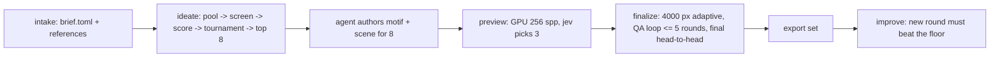

# Architecture

logo-maker turns a brief into a judged, rendered 3D logo and an export set. Three actors share the
work:

- **The agent** (guided by `skills/logo-maker/SKILL.md`) writes the brief, drafts metaphors, and
  authors a motif and a scene for each shortlisted concept.
- **Jev** (TypeSafe's System One model) answers typed questions about text and images. It never
  decides;
  code turns its answers into actions through truth tables.
- **The tool** does everything else: builds the concept pool, runs the judging chain, renders, runs
  the QA loop, exports, and logs.

No stage generates images with an AI model. Every pixel comes from geometry, fonts, materials, and
renderers.

## Pipeline



| Stage | Command | Reads | Writes |
|---|---|---|---|
| intake | `new`, `intake` | user input | `brief.toml`, `inputs/`, `ideation/intake.json` |
| ideate | `ideate` | brief, `ideation/metaphors.toml`, catalog | `ideation/pool.jsonl`, `stage1.jsonl`, `stage2.jsonl`, `tournament.jsonl`, `shortlist.json`, `concepts/<slug>/concept.json` |
| author motifs | (agent) | `concept.json` | `concepts/<slug>/motif.py` or `motif.svg` |
| motifs | `motifs` | motif sources | `motif.svg`, `motif.json`, `motif-sizes.png`; starter `scene.toml` once (layer-aware, one material per motif role) |
| author scenes | (agent) | starter `scene.toml` | tuned `scene.toml`, optional `scene.py` |
| preview | `preview` | concepts | `preview.png`, `ideation/finalists.json` |
| finalize | `finalize` | finalists | `final.png`, `scene.blend`, `model.glb`, `qa/rounds.jsonl`, `ideation/winner.json` |
| export | `export` | winner | `exports/*` |

Every stage records its status in `run.json` and skips work whose outputs exist, so any stage can be
resumed. `run` chains the stages and stops with a clear message where agent authoring is needed.

## Logo folder

`logos/<slug>/` (or `--out DIR`), laid out by `logo_maker.paths.LogoDir`:

```text
brief.toml            the brief (logo_maker.brief)
inputs/               references the user supplied
ideation/             metaphors.toml, pool + chain results, shortlist/finalists/winner
concepts/<slug>/      motif.py|motif.svg, motif.json, scene.toml, preview.png, final.png, scene.blend, model.glb
qa/                   jev/requests/*.json (images replaced by sha256), jev/assets/<sha256>.png, rounds.jsonl
exports/              the export set
run.json              seeds, versions, stage status, jev usage and cost, asset licenses (logo_maker.runlog)
```

Concept ids are `metaphor|treatment|material`; folders are `metaphor--treatment--material`.

## Contracts

### Motif (2D master)

`concepts/<slug>/motif.svg` is the single source of 2D geometry. The flat SVG exports, the favicons,
and every 3D relief come from it, so flat and 3D always match.

- `viewBox="0 0 1000 1000"`, y down. The mark fits inside a centered circle of radius 470.
- Only `<path>` elements, absolute coordinates, no transforms, no strokes (strokes are outlined
  first).
- Each path has a unique `id`, a `fill="#RRGGBB"`, and optional attributes:
  - `data-role`: palette role (`primary`, `secondary`, `accent`, `highlight`, `ink`); the mono
export
    recolors every role to one ink.
  - `data-height`: relief height multiplier for 3D (default `1`).
  - `data-layer`: integer stacking order for layered treatments (default `0`).
- The agent writes `motif.py` (preferred; uses `logo_maker.motif` to place glyphs, shapes, booleans,
  and 2D tool output, then calls `save()`), or writes `motif.svg` directly in this format.

`motif.json` is derived by `logo_maker.motif.flatten()`:

```json
{"viewbox": 1000,
 "layers": [{"id": "mark", "fill": "#1E4A7A", "role": "primary", "height": 1.0, "layer": 0,
             "contours": [[[x, y], ...], ...]}]}
```

Contours are closed polylines (curves flattened at 12 steps), overlaps removed with skia-pathops,
holes as separate contours (even-odd fill).

### Scene (3D recipe)

`concepts/<slug>/scene.toml` composes components from the catalog. `logo_maker.scene` validates it;
the Blender builder (`logo_maker/blender/`) runs it inside a `bpy` subprocess. Units: the motif's
1000-unit box maps to 2.0 scene units (the radius-470 circle becomes radius 0.94).

```toml
[meta]
concept = "metaphor|treatment|material"
treatment = "embossed_plate"     # catalog preset this scene started from (informational)
seed = 1234                      # from run.json

[camera]
tilt_deg = 28                    # 0 = straight on
lens_mm = 100
framing = 0.84                   # fraction of the frame the object's bounds fill

[lighting]
rig = "studio_soft"              # catalog/lighting.toml
hdri = "polyhaven:studio_small_09"   # or "none"
hdri_strength = 0.45

[render]
renderer = "cycles"              # cycles | mitsuba | luxcore | three
look = "photoreal"               # photoreal | toon | lineart
glare = 0.0                      # compositor glare mix (0 = off)
dof_fstop = 0.0                  # 0 = no depth of field

[materials.surface]              # any number of named materials
preset = "porcelain"             # catalog/materials.toml
color = "#F8F6F1"                # overrides the preset's base color

[[components]]
kind = "plate"                   # see catalog/components.md for every kind and its fields
material = "surface"
```

Component kinds (each documented in `logo_maker/catalog/components.md`): `plate` (outline from a
shape or the motif silhouette, optional irregular edge, bevel), `recess` (pressed or cut area in a
plate), `rim` (torus or raised border), `relief` (motif layers raised or cut), `extrude`
(freestanding motif solid), `inflate` (soft rounded motif via signed distance fields), `layers`
(stacked cut-outs by `data-layer`),
`ring_text` (text set on a circle), `ribbon` (cloth strip, optionally physics-draped), `tube` (motif
centerline as a swept tube), `voxels` (motif rasterized to cubes), `cad` (build123d solid), `mesh`
(imported OBJ/STL/PLY/GLB), `bpy` (agent-written `scene.py` fallback with a `build(ctx)` function).

### Render

`logo_maker.render.render(concept_dir, quality)` runs `python -m logo_maker.blender.build` in a
subprocess with the current interpreter and returns a `RenderResult` (png, blend, glb, seconds,
execution). `execution` points to `.build/<quality>.execution.json` for the builder's Cycles
render; its adjacent `.log` retains native denoiser diagnostics. Alternate renderer output is
outside this Cycles execution attestation.

| quality | resolution | samples | use |
|---|---|---|---|
| `test` | 256 px | 64 + denoise | regression test |
| `preview` | 1000 px | 256 + denoise | jev preview screen |
| `final` | 4000 px, downsampled to 2000 px | adaptive 0.01, max 4096, denoise | finals and exports |

GPU contract (#4, shared with #5): the actual bpy process refreshes devices, disables all CPU
tracing selections, selects one available Metal device, and forces the Cycles Metal device override.
MetalRT stays `AUTO`. GPU denoising is a separate requirement: support/request flags alone do not
prove execution. Each render must retain effective OIDN Metal runtime evidence or fail
operationally;
CPU/hybrid tracing and CPU denoising are never accepted. Normal CPU scene construction,
synchronization,
Metal submission, image analysis and file I/O remain permitted. Execution verification is
independent
of craftsmanship, fidelity, brief fit and aesthetic preference.
First runs compile Metal kernels (1.5-5 min, no output); a builder attempt is limited to 900 s
and the remaining job deadline. Crash retries consume the same attempt and wall-clock budget.
Sampling remains the table's baseline until #5 qualifies replacement settings at 4000→2000 px.
Per-render evidence records build, device selections, effective sampling/seed, denoiser evidence and
timing scope; #5 can consume it without changing numeric defaults.
When the scene asks for `mitsuba`, `luxcore`, or `three`, the builder exports meshes, materials,
camera, and lights to `concepts/<slug>/meshes/scene_export.json`, and the matching renderer in
`logo_maker/renderers/` renders from that.

### Bounded sampling (#5)

The sampling policy is a separate technical contract, not a craftsmanship gate. See
[automatic-sampling.md](automatic-sampling.md) for the profile schema and qualification protocol.
`[render]` exposes `adaptive`, `adaptive_threshold`, `min_samples`, `max_samples`, and `seed`.
Explicit values (including false and zero) are retained in compiled `quality.overrides` and never
rewritten by QA. Zero minimum delegates to Cycles; zero threshold means Cycles automatic threshold,
not zero error. `meta.seed` supplies the deterministic seed unless explicitly overridden.

`[sampling]` exposes `profile` (optional JSON path), `diagnosis` (optional JSON path),
`wall_seconds` (default 1800), `attempt_limit` (default 2, maximum 4), and
`diagnostic_bytes` (default 2147483648, maximum 2147483648 per attempt).
No replacement profile is shipped as qualified. Missing/stale/out-of-scope profiles retain the
4096 / 0.01 final comparator and return `profile_unqualified`; they cannot certify completion.
A qualified profile matches the actual machine/OS/build/Blender/OIDN library/backend/device,
Python and image/geometry library versions plus the project lockfile,
stage, resolution, render configuration and dependency scope. Owner-reviewed controls and held-out
cases are required. Profile timing distributions exclude seed; image/diagnosis identity includes
seed.
No image result is reused solely on an mtime or a machine timing key. Custom `bpy` components
remain outside profile qualification and image reuse until their arbitrary file dependencies
can be inventoried; direct inspection renders retain an unresolved state.

`sampling.decide` consumes an image-bound diagnosis naming the reviewed diagnostic region
plus that region’s sample statistics. Saturation elsewhere cannot select a cap repair. Generic edge
QA
alone never increases sampling. Verified cap-limited stochastic noise can increase only the cap;
verified below-cap noise can tighten only the threshold. Structural, typography, resolution,
filtering, alpha and denoiser-detail defects return `refinement_needed` for #3; missing/uncertain
sampling evidence returns `unknown`. Overrides that prevent a proposed repair return
`override_conflict`. Every optional comparison needs remaining attempts and estimated whole-job
cost; otherwise retain the prior artifact and report `attempt_limit` or `time_limit`.

Each attempt runs through #4's `render_verified` boundary. Optional bounded multilayer EXR retains
Combined, noisy image and normalized Debug Sample Count subimages. Summaries decode counts by
multiplying by the cap, report foreground, dark, alpha-boundary and spatial difficult regions, and
retain missing diagnostics as unknown. Summaries are diagnostics, never an automated quality
verdict.
The final passes through the real 4000→2000 Lanczos path and optional alpha cleanup before
publication.
A failed/device-unverified/over-budget attempt does not replace prior output.
`RenderResult.sampling`
points to a job record with full input/settings/image keys, delivered hash, attempts, total host
wall
time, execution/denoiser evidence and distinct profile/noise/cap/time/memory/device/quality
outcomes.
Cold/kernel state remains unknown unless observed. Calibration and confirmations are part of cost,
not a free prelude. Heavy CPU host stages (compilation and image processing/diagnostics) run
in owned workers, interrupted at the remaining deadline, including startup and cleanup.
Workers may perform required CPU host work; GPU tracing and denoising still use #4.
Asset-use records return as typed `RenderResult.assets` and in the sampling sidecar.
An arbitrary `on_asset`
callback conflicts with bounded rendering: its in-process effects cannot be preserved in
a killable worker. Rendering reports that conflict before invoking it. Direct `scene.compile`
still supports callbacks for caller-managed work. Light
orchestration checks the shared deadline between operations. Native render work is interrupted
at the remaining deadline.
Configuration loading and cached-image/dependency validation also run in owned workers.
Profile/control JSON loading and qualification evidence reads use the same owned-worker
deadline. The worker returns effective settings with explicit overrides preserved, the
qualification result, diagnosis and hashes of the control bytes it loaded. A timeout
retains prior output and cannot start a GPU attempt.
Configuration uses the caller's deadline or the default 1800 s bootstrap ceiling until
its settings are known; the scene deadline then includes that elapsed setup time.
`render_many` has no compilation prepass outside those concept budgets. Host-phase timings
and the execution paths of interrupted attempts remain available in the sampling record.
Light publication/orchestration and QA/provider work remain
cooperative and are not yet qualified as a hard whole-job bound.

Finalize shares a budget across candidates/QA, and export shares it when invoked by `run`.
Standalone export starts its own explicit budget and retains the final's sampling provenance in the
export manifest. Unqualified sampling returns an authoring/review stop and cannot advance to winner.
The owned export worker loads and hashes sampling provenance, checks the delivered final
image hash, and builds the export manifest. A blocked provenance read therefore consumes
the same deadline as image and adapter work, before export publication.
Issue #2 must independently enforce craftsmanship, brief fit and preference, including for a
technically
accepted or capped image. A capped image is never described as proven convergence.

Bounded export on macOS/Linux starts the worker in its own process session. One second
of the remaining budget is reserved for termination/reaping: SIGTERM reaches Node/Chrome
launcher cleanup hooks, followed by SIGKILL for remaining session members. Insufficient
cleanup reserve rejects the attempt before launch. Arbitrary uncooperative processes that
escape that session are outside the supported adapter contract.
macOS can report EPERM for a group containing only exited, unreaped processes. On this
error, bounded `/bin/ps` inspection checks only group IDs and process states. An empty or
all-zombie group has stopped work; a live member or failed inspection is an explicit
unconfirmed-cleanup failure. Permission errors are never silently treated as success.

### Qualification fixtures

`benchmarks/omp/` is a provenance bundle, never a brand-default source. Its manifest binds each
retained image, flat mark and recipe dependency to a SHA-256, origin and permitted-use note.
Historical CPU-rendered originals, the 256 px renderer golden, the fresh 2000 px reconstruction,
and new GPU replays retain separate identities. Replays do not replace original bytes.
The verifier rejects missing/changed assets and reports owner labels per dimension: reproduction
fidelity, craftsmanship, brief fit and preference. Unknown/missing labels remain unknown. No
aggregate
quality winner is inferred from SSIM, gloss or hardware. Transfer qualification needs owner-reviewed
different-material successes and held-out briefs, plus rejected Skill Swap controls; missing cases
leave qualification open. The small SSIM check covers renderer regression only.

### Jev

All wording and thresholds live in `logo_maker/jev/questions.py`. `logo_maker.jev.client.JevClient`
sends requests to OpenRouter `POST https://openrouter.ai/api/alpha/decisions` (`OPENROUTER_API_KEY`,
model `typesafe/jev-1.14`), or to TypeSafe `POST https://api.typesafe.ai/v1/systemone` when
`TYPESAFE_API_KEY` is set. Requests with images send base64 assets with
`TypeSafe-Danger-Zone-Images: true`. Every request is logged to `qa/jev/requests/` with each image
replaced by its sha256, and each image is stored once in `qa/jev/assets/`. 429/5xx retry with
backoff; any other failure raises `JevError` and never reads as "no".

### Adapters

Every external tool is an `Adapter` (`logo_maker/adapters/__init__.py`): name, stage, license,
one-line
summary, the callable that runs it, a health check, and the exact fix command. See
[adapters.md](adapters.md). `logo_maker.doctor.checks()` runs every adapter check plus the
environment
checks (jev API key, Node.js, Cycles Metal GPU, Metal kernel cache) and returns one row per check:
`stage`, `name`, `ok`, `problem`, `fix`. `logo-maker doctor` prints those rows and exits 1 when any
row is not ok; the MCP `logo_doctor` tool returns the same rows plus `passed` and `failed` counts.
Every check is required: there are no optional tools.
