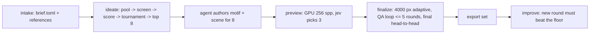

# Architecture

logo-maker turns a brief into a judged, rendered 3D logo and an export set. Three actors share the work:

- **The agent** (guided by `skills/logo-maker/SKILL.md`) writes the brief, drafts metaphors, and
  authors a motif and a scene for each shortlisted concept.
- **Jev** (TypeSafe's System One model) answers typed questions about text and images. It never decides;
  code turns its answers into actions through truth tables.
- **The tool** does everything else: builds the concept pool, runs the judging chain, renders, runs
  the QA loop, exports, and logs.

No stage generates images with an AI model. Every pixel comes from geometry, fonts, materials, and renderers.

## Pipeline



| Stage | Command | Reads | Writes |
|---|---|---|---|
| intake | `new`, `intake` | user input | `brief.toml`, `inputs/`, `ideation/intake.json` |
| ideate | `ideate` | brief, `ideation/metaphors.toml`, catalog | `ideation/pool.jsonl`, `stage1.jsonl`, `stage2.jsonl`, `tournament.jsonl`, `shortlist.json`, `concepts/<slug>/concept.json` |
| author motifs | (agent) | `concept.json` | `concepts/<slug>/motif.py` or `motif.svg` |
| motifs | `motifs` | motif sources | `motif.svg`, `motif.json`, `motif-sizes.png`; starter `scene.toml` once (layer-aware, one material per motif role) |
| author scenes | (agent) | starter `scene.toml` | tuned `scene.toml`, optional `scene.py` |
| preview | `preview` | concepts | `preview.png`, `ideation/finalists.json` |
| finalize | `finalize` | finalists | `final.png`, `scene.blend`, `model.glb`, `qa/rounds.jsonl`, `ideation/winner.json` |
| export | `export` | winner | `exports/*` |

Every stage records its status in `run.json` and skips work whose outputs exist, so any stage can be
resumed. `run` chains the stages and stops with a clear message where agent authoring is needed.

## Logo folder

`logos/<slug>/` (or `--out DIR`), laid out by `logo_maker.paths.LogoDir`:

```text
brief.toml            the brief (logo_maker.brief)
inputs/               references the user supplied
ideation/             metaphors.toml, pool + chain results, shortlist/finalists/winner
concepts/<slug>/      motif.py|motif.svg, motif.json, scene.toml, preview.png, final.png, scene.blend, model.glb
qa/                   jev/requests/*.json (images replaced by sha256), jev/assets/<sha256>.png, rounds.jsonl
exports/              the export set
run.json              seeds, versions, stage status, jev usage and cost, asset licenses (logo_maker.runlog)
```

Concept ids are `metaphor|treatment|material`; folders are `metaphor--treatment--material`.

## Contracts

### Motif (2D master)

`concepts/<slug>/motif.svg` is the single source of 2D geometry. The flat SVG exports, the favicons,
and every 3D relief come from it, so flat and 3D always match.

- `viewBox="0 0 1000 1000"`, y down. The mark fits inside a centered circle of radius 470.
- Only `<path>` elements, absolute coordinates, no transforms, no strokes (strokes are outlined first).
- Each path has a unique `id`, a `fill="#RRGGBB"`, and optional attributes:
  - `data-role`: palette role (`primary`, `secondary`, `accent`, `highlight`, `ink`); the mono export
    recolors every role to one ink.
  - `data-height`: relief height multiplier for 3D (default `1`).
  - `data-layer`: integer stacking order for layered treatments (default `0`).
- The agent writes `motif.py` (preferred; uses `logo_maker.motif` to place glyphs, shapes, booleans,
  and 2D tool output, then calls `save()`), or writes `motif.svg` directly in this format.

`motif.json` is derived by `logo_maker.motif.flatten()`:

```json
{"viewbox": 1000,
 "layers": [{"id": "mark", "fill": "#1E4A7A", "role": "primary", "height": 1.0, "layer": 0,
             "contours": [[[x, y], ...], ...]}]}
```

Contours are closed polylines (curves flattened at 12 steps), overlaps removed with skia-pathops,
holes as separate contours (even-odd fill).

### Scene (3D recipe)

`concepts/<slug>/scene.toml` composes components from the catalog. `logo_maker.scene` validates it;
the Blender builder (`logo_maker/blender/`) runs it inside a `bpy` subprocess. Units: the motif's
1000-unit box maps to 2.0 scene units (the radius-470 circle becomes radius 0.94).

```toml
[meta]
concept = "metaphor|treatment|material"
treatment = "embossed_plate"     # catalog preset this scene started from (informational)
seed = 1234                      # from run.json

[camera]
tilt_deg = 28                    # 0 = straight on
lens_mm = 100
framing = 0.84                   # fraction of the frame the object's bounds fill

[lighting]
rig = "studio_soft"              # catalog/lighting.toml
hdri = "polyhaven:studio_small_09"   # or "none"
hdri_strength = 0.45

[render]
renderer = "cycles"              # cycles | mitsuba | luxcore | three
look = "photoreal"               # photoreal | toon | lineart
glare = 0.0                      # compositor glare mix (0 = off)
dof_fstop = 0.0                  # 0 = no depth of field

[materials.surface]              # any number of named materials
preset = "porcelain"             # catalog/materials.toml
color = "#F8F6F1"                # overrides the preset's base color

[[components]]
kind = "plate"                   # see catalog/components.md for every kind and its fields
material = "surface"
```

Component kinds (each documented in `logo_maker/catalog/components.md`): `plate` (outline from a
shape or the motif silhouette, optional irregular edge, bevel), `recess` (pressed or cut area in a
plate), `rim` (torus or raised border), `relief` (motif layers raised or cut), `extrude`
(freestanding motif solid), `inflate` (soft rounded motif via signed distance fields), `layers`
(stacked cut-outs by `data-layer`),
`ring_text` (text set on a circle), `ribbon` (cloth strip, optionally physics-draped), `tube` (motif
centerline as a swept tube), `voxels` (motif rasterized to cubes), `cad` (build123d solid), `mesh`
(imported OBJ/STL/PLY/GLB), `bpy` (agent-written `scene.py` fallback with a `build(ctx)` function).

### Render

`logo_maker.render.render(concept_dir, quality)` runs `python -m logo_maker.blender.build` in a
subprocess with the current interpreter and returns a `RenderResult` (png, blend, glb, seconds).

| quality | resolution | samples | use |
|---|---|---|---|
| `test` | 256 px | 64 + denoise | regression test |
| `preview` | 1000 px | 256 + denoise | jev preview screen |
| `final` | 4000 px, downsampled to 2000 px | adaptive 0.01, max 4096, denoise | finals and exports |

GPU: Metal with `refresh_devices()` before `device = "GPU"`, MetalRT `AUTO`, OIDN on GPU. First runs
compile Metal kernels (1.5-5 min, no output); renders time out at 600 s and retry once on a crash.
When the scene asks for `mitsuba`, `luxcore`, or `three`, the builder exports meshes, materials,
camera, and lights to `concepts/<slug>/meshes/scene_export.json`, and the matching renderer in
`logo_maker/renderers/` renders from that.

### Jev

All wording and thresholds live in `logo_maker/jev/questions.py`. `logo_maker.jev.client.JevClient`
sends requests to OpenRouter `POST https://openrouter.ai/api/alpha/decisions` (`OPENROUTER_API_KEY`,
model `typesafe/jev-1.14`), or to TypeSafe `POST https://api.typesafe.ai/v1/systemone` when
`TYPESAFE_API_KEY` is set. Requests with images send base64 assets with
`TypeSafe-Danger-Zone-Images: true`. Every request is logged to `qa/jev/requests/` with each image
replaced by its sha256, and each image is stored once in `qa/jev/assets/`. 429/5xx retry with
backoff; any other failure raises `JevError` and never reads as "no".

### Adapters

Every external tool is an `Adapter` (`logo_maker/adapters/__init__.py`): name, stage, license, one-line
summary, the callable that runs it, a health check, and the exact fix command. See
[adapters.md](adapters.md). `logo_maker.doctor.checks()` runs every adapter check plus the environment
checks (jev API key, Node.js, Cycles Metal GPU, Metal kernel cache) and returns one row per check:
`stage`, `name`, `ok`, `problem`, `fix`. `logo-maker doctor` prints those rows and exits 1 when any
row is not ok; the MCP `logo_doctor` tool returns the same rows plus `passed` and `failed` counts.
Every check is required: there are no optional tools.
