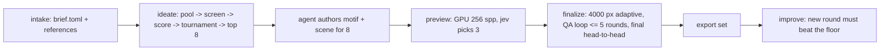

# Architecture

logo-maker turns a brief into a judged, rendered 3D logo and an export set. Three actors share the work:

- **The agent** (guided by `skills/logo-maker/SKILL.md`) writes the brief, drafts metaphors, and
  authors a motif and a scene for each shortlisted concept.
- **Jev** (TypeSafe's System One model) answers typed questions about text and images. It never decides;
  code turns its answers into actions through truth tables.
- **The tool** does everything else: builds the concept pool, runs the judging chain, renders, runs
  the QA loop, exports, and logs.

No stage generates images with an AI model. Every pixel comes from geometry, fonts, materials, and renderers.

## Pipeline



| Stage | Command | Reads | Writes |
|---|---|---|---|
| intake | `new`, `intake` | user input | `brief.toml`, `inputs/`, `ideation/intake.json` |
| ideate | `ideate` | brief, `ideation/metaphors.toml`, catalog | `ideation/pool.jsonl`, `stage1.jsonl`, `stage2.jsonl`, `tournament.jsonl`, `shortlist.json`, `concepts/<slug>/concept.json` |
| author motifs | (agent) | `concept.json` | `concepts/<slug>/motif.py` or `motif.svg` |
| motifs | `motifs` | motif sources | `motif.svg`, `motif.json`, `motif-sizes.png`; starter `scene.toml` once (layer-aware, one material per motif role) |
| author scenes | (agent) | starter `scene.toml` | tuned `scene.toml`, optional `scene.py` |
| preview | `preview` | concepts | `preview.png`, `ideation/finalists.json` |
| finalize | `finalize` | finalists | `final.png`, `scene.blend`, `model.glb`, `qa/rounds.jsonl`, `ideation/winner.json` |
| export | `export` | winner | `exports/*` |

Every stage records its status in `run.json` and skips work whose outputs exist, so any stage can be
resumed. `run` chains the stages and stops with a clear message where agent authoring is needed.

## Logo folder

`logos/<slug>/` (or `--out DIR`), laid out by `logo_maker.paths.LogoDir`:

```text
brief.toml            the brief (logo_maker.brief)
inputs/               references the user supplied
ideation/             metaphors.toml, pool + chain results, shortlist/finalists/winner
concepts/<slug>/      motif.py|motif.svg, motif.json, scene.toml, preview.png, final.png, scene.blend, model.glb
qa/                   jev/requests/*.json (images replaced by sha256), jev/assets/<sha256>.png, rounds.jsonl
exports/              the export set
run.json              seeds, versions, stage status, jev usage and cost, asset licenses (logo_maker.runlog)
```

Concept ids are `metaphor|treatment|material`; folders are `metaphor--treatment--material`.

## Contracts

### Motif (2D master)

`concepts/<slug>/motif.svg` is the single source of 2D geometry. The flat SVG exports, the favicons,
and every 3D relief come from it, so flat and 3D always match.

- `viewBox="0 0 1000 1000"`, y down. The mark fits inside a centered circle of radius 470.
- Only `<path>` elements, absolute coordinates, no transforms, no strokes (strokes are outlined first).
- Each path has a unique `id`, a `fill="#RRGGBB"`, and optional attributes:
  - `data-role`: palette role (`primary`, `secondary`, `accent`, `highlight`, `ink`); the mono export
    recolors every role to one ink.
  - `data-height`: relief height multiplier for 3D (default `1`).
  - `data-layer`: integer stacking order for layered treatments (default `0`).
- The agent writes `motif.py` (preferred; uses `logo_maker.motif` to place glyphs, shapes, booleans,
  and 2D tool output, then calls `save()`), or writes `motif.svg` directly in this format.

`motif.json` is derived by `logo_maker.motif.flatten()`:

```json
{"viewbox": 1000,
 "layers": [{"id": "mark", "fill": "#1E4A7A", "role": "primary", "height": 1.0, "layer": 0,
             "contours": [[[x, y], ...], ...]}]}
```

Contours are closed polylines (curves flattened at 12 steps), overlaps removed with skia-pathops,
holes as separate contours (even-odd fill).

### Scene (3D recipe)

`concepts/<slug>/scene.toml` composes components from the catalog. `logo_maker.scene` validates it;
the Blender builder (`logo_maker/blender/`) runs it inside a `bpy` subprocess. Units: the motif's
1000-unit box maps to 2.0 scene units (the radius-470 circle becomes radius 0.94).

```toml
[meta]
concept = "metaphor|treatment|material"
treatment = "embossed_plate"     # catalog preset this scene started from (informational)
seed = 1234                      # from run.json

[camera]
tilt_deg = 28                    # 0 = straight on
lens_mm = 100
framing = 0.84                   # fraction of the frame the object's bounds fill

[lighting]
rig = "studio_soft"              # catalog/lighting.toml
hdri = "polyhaven:studio_small_09"   # or "none"
hdri_strength = 0.45

[render]
renderer = "cycles"              # cycles | mitsuba | luxcore | three
look = "photoreal"               # photoreal | toon | lineart
glare = 0.0                      # compositor glare mix (0 = off)
dof_fstop = 0.0                  # 0 = no depth of field

[materials.surface]              # any number of named materials
preset = "porcelain"             # catalog/materials.toml
color = "#F8F6F1"                # overrides the preset's base color

[[components]]
kind = "plate"                   # see catalog/components.md for every kind and its fields
material = "surface"
```

Component kinds (each documented in `logo_maker/catalog/components.md`): `plate` (outline from a
shape or the motif silhouette, optional irregular edge, bevel), `recess` (pressed or cut area in a
plate), `rim` (torus or raised border), `relief` (motif layers raised or cut), `extrude`
(freestanding motif solid), `inflate` (soft rounded motif via signed distance fields), `layers`
(stacked cut-outs by `data-layer`),
`ring_text` (text set on a circle), `ribbon` (cloth strip, optionally physics-draped), `tube` (motif
centerline as a swept tube), `voxels` (motif rasterized to cubes), `cad` (build123d solid), `mesh`
(imported OBJ/STL/PLY/GLB), `bpy` (agent-written `scene.py` fallback with a `build(ctx)` function).

### Render

`logo_maker.render.render(concept_dir, quality)` runs `python -m logo_maker.blender.build` in a
subprocess with the current interpreter and returns a `RenderResult` (png, blend, glb, seconds,
execution). `execution` points to `.build/<quality>.execution.json` for the builder's Cycles
render; its adjacent `.log` retains native denoiser diagnostics. Host postprocessing binds the
delivered pixels and source files to that evidence. Alternate renderers currently lack equivalent
verified GPU tracing/denoising and are rejected operationally at the public render boundary.

| quality | resolution | samples | use |
|---|---|---|---|
| `test` | 256 px | 64 + denoise | regression test |
| `preview` | 1000 px | 256 + denoise | jev preview screen |
| `final` | 4000 px, downsampled to 2000 px | adaptive 0.01, max 4096, denoise | finals and exports |

GPU contract (#4, shared with #5): the actual bpy process refreshes devices, disables all CPU
tracing selections, selects one available Metal device, and forces the Cycles Metal device override.
MetalRT stays `AUTO`. GPU denoising is a separate requirement: support/request flags alone do not
prove execution. Each render must retain effective OIDN Metal runtime evidence or fail operationally;
CPU/hybrid tracing and CPU denoising are never accepted. Normal CPU scene construction, synchronization,
Metal submission, image analysis and file I/O remain permitted. Execution verification is independent
of craftsmanship, fidelity, brief fit and aesthetic preference.
First runs compile Metal kernels (1.5-5 min, no output); renders time out at 900 s and retry once
on a crash.
Sampling remains the table's baseline until #5 qualifies replacement settings at 4000→2000 px.
Per-render evidence records build, device selections, effective sampling/seed, denoiser evidence and
timing scope; #5 can consume it without changing numeric defaults.
The alternate renderer modules remain available for development, but cannot supply production
eligibility under the GPU-only contract until they have equivalent independent execution evidence.

### Qualification fixtures

`benchmarks/omp/` is a provenance bundle, never a brand-default source. Its manifest binds each
retained image, flat mark and recipe dependency to a SHA-256, origin and permitted-use note.
Historical CPU-rendered originals, the 256 px renderer golden, the fresh 2000 px reconstruction,
and new GPU replays retain separate identities. Replays do not replace original bytes.
The verifier rejects missing/changed assets and reports owner labels per dimension: reproduction
fidelity, craftsmanship, brief fit and preference. Unknown/missing labels remain unknown. No aggregate
quality winner is inferred from SSIM, gloss or hardware. Transfer qualification needs owner-reviewed
different-material successes and held-out briefs, plus rejected Skill Swap controls; missing cases
leave qualification open. The small SSIM check covers renderer regression only.

### Jev

### Visual eligibility (#2)

`brief.toml` declares `intended_appearance` and repeatable `[[references]]` with
`use = "craft"`. Each craft reference's `note` describes its intended treatment.
These references demonstrate execution quality only: they do not supply the candidate's
palette, geometry, lettering, material, symbolism or preferred finish. Style and geometry
references retain their separate meanings. No bundled example is an implicit craft floor.

Before preview finalists and again before the final tournament (including a lone survivor),
compare the actual candidate and every craft reference in both presentation orders. Separate
requests judge execution against the reference's demonstrated floor, symbol/concept fit,
intended appearance, and technical image acceptance. The stricter rubric requires controlled
contours/joins, surfaces, details, edge refinement, material construction, proportions, hierarchy
and lighting. Own-brief fit additionally requires a developed brand-specific idea, purposeful
visual synthesis, constraint fidelity and communicative clarity: merely depicting a category
icon is insufficient. Every criterion is essential; appeal cannot compensate for one failure.
Preference ranks only eligible candidates.
Equality to the craft floor passes; a forced Choice, appeal, hardware provenance, or tournament
position cannot establish eligibility. Fit requests receive the candidate's brief and concept,
never the unrelated reference's design. Gloss, reflections and roundness are assessed relative
to the two intended treatments, without a universal preference for either finish.

Small-size judgments receive the actual flat master and the hero reduced to 32 px and enlarged
with nearest-neighbor pixels; secondary hero lettering is not required at favicon size. Images
larger than the provider's whole-image limit additionally supply every native-pixel tile for
craft and technical checks. Separate sequential calls cover each reference/order, own-brief fit,
and technical detail. `view_sha256` binds derived evidence; the transport retains the sent bytes.

Every essential Noul uses the named bands in `questions.py`: yes passes, no fails, and
unsettled requires review. Missing inputs produce `missing_evidence`; malformed answers and
provider failures produce `api_error` and remain exceptions. `qa/eligibility.jsonl` retains
per-dimension outcomes, both orders, source-image SHA-256s, brief/concept/recipe revision,
rubric hash and sampling/execution evidence. The transport additionally retains the exact
encoded pixels/model/questions. Render-policy failures are operational errors and never craft
labels. Final eligibility must bind the current pixels and inputs; export rejects stale winner
evidence. Failed selection leaves existing winner, exports and same-brand improvement floor
untouched. `improve` still separately requires beating that brand's previous winner.
An optional `qa/owner-feedback.json` array binds explicit owner feedback to candidate image,
brief SHA-256 and concept ID. A craft or fit rejection vetoes advancement while preserving model
answers. Owner approval does not replace any essential model/evidence gate. Changed feedback
invalidates export proof, and unranked preference remains independent.

Sampling evidence has separate noise, resource-limit, detail/structure and device fields.
Absent sample-count diagnostics remain unknown, never convergence. A capped or diagnostically
unknown image can qualify only through independently recorded full-image visual acceptance,
with its limit/unknown state retained. Denoiser smoothing, persistent aliasing and wrong structure
cannot be cured by passing craft/preference judgments. A generic edge failure requests diagnosis;
it never automatically raises samples or changes the threshold. #5 owns future qualified
profiles and bounded diagnosis-driven adjustments; baseline settings remain unchanged here.

### Jev transport

All wording and thresholds live in `logo_maker/jev/questions.py`. `logo_maker.jev.client.JevClient`
sends requests to OpenRouter `POST https://openrouter.ai/api/alpha/decisions` (`OPENROUTER_API_KEY`,
model `typesafe/jev-1.14`), or to TypeSafe `POST https://api.typesafe.ai/v1/systemone` when
`TYPESAFE_API_KEY` is set. Requests with images send base64 assets with
`TypeSafe-Danger-Zone-Images: true`. Every request is logged to `qa/jev/requests/` with each image
replaced by its sha256, and each image is stored once in `qa/jev/assets/`. 429/5xx retry with
backoff; any other failure raises `JevError` and never reads as "no".

### Adapters

Every external tool is an `Adapter` (`logo_maker/adapters/__init__.py`): name, stage, license, one-line
summary, the callable that runs it, a health check, and the exact fix command. See
[adapters.md](adapters.md). `logo_maker.doctor.checks()` runs every adapter check plus the environment
checks (jev API key, Node.js, Cycles Metal GPU, Metal kernel cache) and returns one row per check:
`stage`, `name`, `ok`, `problem`, `fix`. `logo-maker doctor` prints those rows and exits 1 when any
row is not ok; the MCP `logo_doctor` tool returns the same rows plus `passed` and `failed` counts.
Every check is required: there are no optional tools.
