# Architecture

logo-maker turns a brief into a judged, rendered 3D logo and an export set. Three actors share the
work:

- **The agent** (guided by `skills/logo-maker/SKILL.md`) writes the brief, drafts metaphors, and
  authors a motif and a scene for each shortlisted concept.
- **Jev** (TypeSafe's System One model) answers typed questions about text and images. It never
  decides;
  code turns its answers into actions through truth tables.
- **The tool** does everything else: builds the concept pool, runs the judging chain, renders, runs
  the QA loop, exports, and logs.

No stage generates images with an AI model. Every pixel comes from geometry, fonts, materials, and
renderers.

## Pipeline

```mermaid
flowchart LR
  brief[brief: evidence review + freeze] --> intake[intake: references + palette/fonts]
  intake --> ideate[ideate: pool -> screen -> score -> tournament -> top 8]
  ideate --> author[agent authors plan + motif + scene for 8]
  author --> plan[plan: intent + detail review]
  plan --> preview[preview: GPU 256 spp, jev picks 3]
  preview --> finalize[finalize: 4000 px adaptive, QA loop <= 5 rounds, final head-to-head]
  finalize --> export[export set]
  export --> improve[improve: new round must beat the floor]
```



| Stage | Command | Reads | Writes |
|---|---|---|---|
| brief | `new`, `brief` | project/owner evidence, `brief.toml`, `brief-evidence.toml`, reference roles/hashes | `ideation/requirements.json`, `qa/brief-reviews.jsonl` |
| intake | `intake` | current frozen brief, references, proposals | `ideation/intake.json`, palette/fonts |
| ideate | `ideate` | brief, `ideation/metaphors.toml`, catalog | `ideation/pool.jsonl`, `stage1.jsonl`, `stage2.jsonl`, `tournament.jsonl`, `shortlist.json`, `concepts/<slug>/concept.json` |
| author motifs | (agent) | `concept.json` | `concepts/<slug>/motif.py` or `motif.svg` |
| motifs | `motifs` | motif sources | `motif.svg`, `motif.json`, `motif-sizes.png`; starter `scene.toml` once (layer-aware, one material per motif role) |
| author scenes | (agent) | starter `scene.toml` | tuned `scene.toml`, optional `scene.py` |
| plan | `plan` | current requirements, `concept.json`, `plan.toml` | `plan-review.json`, `qa/plan-reviews.jsonl` |
| preview | `preview` | concepts | `preview.png`, `ideation/finalists.json` |
| finalize | `finalize` | finalists | `final.png`, `scene.blend`, `model.glb`, `qa/rounds.jsonl`, `ideation/winner.json` |
| export | `export` | winner | `exports/*` |

Every stage records its status in `run.json` and skips work whose outputs exist, so any stage can be
resumed. `run` chains the stages and stops with a clear message where agent authoring is needed.

## Logo folder

`logos/<slug>/` (or `--out DIR`), laid out by `logo_maker.paths.LogoDir`:

```text
brief.toml            the brief (logo_maker.brief)
brief-evidence.toml   sourced facts, mandates, proposals, unknowns and design latitude
inputs/               references the user supplied
ideation/             metaphors.toml, pool + chain results, shortlist/finalists/winner
concepts/<slug>/      motif.py|motif.svg, motif.json, scene.toml, preview.png, final.png, scene.blend, model.glb
qa/                   jev/requests/*.json (images replaced by sha256), jev/assets/<sha256>.png, rounds.jsonl
exports/              the export set
run.json              seeds, versions, stage status, jev usage and cost, asset licenses (logo_maker.runlog)
```

Concept ids are `metaphor|treatment|material`; folders are `metaphor--treatment--material`.

## Contracts

### Brief evidence, review and frozen requirements (#2)

`brief.toml` remains the downstream brand/appearance record. Its summary describes the business,
not evidence that a proposed symbol is a good solution. `brief-evidence.toml` separately records:

- `sources`: named owner, project or fixture sources, each with a local path and exact excerpt;
- `facts`: named claims, source IDs and `established`, `assumption`, `unknown` or `conflict` status;
- `requirements`: named business, communication, usage and visual constraints, with origin,
  priority and source IDs; an owner mandate is distinct from a designer's proposal;
- `obligations`: source-linked mandatory workflow instructions, separate from identity attributes.
  Supported kinds are `brief` (clarify against a retained baseline brief), `authoring` (develop
  purposeful detail) and `validation` (compare a declared minimum of distinct craft references).
  Unsupported obligations request authoring work rather than being silently ignored;
- a primary communication priority, explicit design latitude and consequential open questions.

The authoring agent reads available project/owner evidence first. It asks only questions whose
answers change the next design decision. Unsupported claims are removed from the factual brief
or marked as assumptions. Optional design choices can remain open; essential unknowns and
contradictions cannot silently pass. No bundled brand supplies defaults or implied constraints.

`logo-maker brief` / MCP `logo_brief` review this evidence through narrow typed questions.
Code validates structure, source excerpts/revisions and references before asking Jev about
fact support, source-to-requirements completeness, activity, audience, communication priority,
grounding and consistency. The completeness question is unconditional: omitting an extracted
mandate cannot suppress its check. A pass
freezes `ideation/requirements.json`: reviewed brief/evidence, source hashes, exact answers,
question revision and requirement revision. No concept rationale is supplied as proof of business
facts. Raw requests, usage and any error remain in the normal QA log.

Source-to-requirements completeness is evaluated independently for every source, including when
no requirement was extracted. It receives that source's kind/excerpt and only requirements linked
to that source with established authority. Designer proposals cannot prove source coverage;
an owner source requires owner-origin records. Named priority values include their explicit scope
meanings. Every source must pass; no average hides a missing instruction or open choice.
Direction-preservation receives business, specified direction, its explicit open choices and the
requirements. These are separate requests from the remaining brief checks, using the same
centralized questions and thresholds. Narrow states keep business prose and archival metadata
from supplying accidental evidence for a different judgment. The freeze retains their combined
answers and complete underlying source/input revisions; each exact request remains independently
logged. Missing answers or an error in any request cannot supply a pass.
Review-input hashes include the review protocol and transport implementation, so changes to state
preparation cannot silently reuse judgments produced from a different request representation.

Intake requires this review before palette/font work. Ideation and later public stages require
the current frozen revision, including resumed runs. Changed inputs invalidate it. Reopening an
authored brief requires an explicit revision reason and preserves the previous freeze/history;
it does not overwrite existing exports or an improvement floor.

Each authored concept adds `plan.toml`, bound to its requirement revision. It records the visual
hypothesis separately from facts, requirement IDs, assumptions, and a detail ledger: feature,
purpose, intended scale, physical construction and deletion test. The shared flat master carries
the primary identity; secondary construction and material detail may resolve in the hero.
`logo-maker plan` / MCP `logo_plan` review each shortlisted plan, retaining exact answers and hashes
in `qa/plan-reviews.jsonl` and its current `concepts/<id>/plan-review.json`. Plan review must complete
before preview rendering. A plan is authoring intent, never evidence
that the rendered pixels achieve it. Final visual eligibility still judges actual pixels.

Brief/plan review has explicit pass, fail, unsettled, missing-evidence and API-error outcomes.
Fail/unsettled/missing evidence returns named authoring work and consequential questions;
malformed answers and provider errors remain exceptions. Unknown optional choices remain
explicit latitude. There is no requirement to invent a differentiator, make a brief longer,
add ornament, or make every business fact pictorially decodable.

Source completeness covers both identity requirements and obligations. Direction-preservation
judges identity requirements only. A brief obligation compares the proposed brief/evidence with
its retained baseline before freezing. An authoring obligation requires a reviewed detail plan
before preview and separate actual-image realization judgments before advancement. A validation
obligation requires the stated number of distinct craft images; normal eligibility checks every
one in both orders. These obligations stay mandatory at their deadlines; recording one does not
establish that its later outcome has already been achieved. Prior-artifact rejection remains in
artifact-bound feedback/history rather than becoming a new brand attribute.

Validation obligations also pin `expected_references`: each has a descriptive label, input path
and exact SHA-256. Every pinned identity must still be present among the supplied craft references;
two unrelated images cannot satisfy a named comparison merely by meeting its count. Authoring
obligations are sent to plan-coverage and actual-pixel fulfillment judgments in addition to generic
detail realization; a self-selected plan cannot erase the specific requested correction.

New owner feedback records `candidate_sha256` and `input_revision_sha256`, obtained with
`eligibility.owner_review_scope()` before writing the review. This hashes the exact artifact,
brief, requirements, sources, references, concept/plan/scene and rubric, excluding the feedback
file itself to avoid a self-referential hash. Legacy rows keep their known image/brief/concept
scope explicitly; no missing input hash is fabricated. A rejection of unchanged pixels with
changed inputs requires fresh review and remains unsettled, rather than disappearing after a
more flattering explanation. Only an explicit current-scope overall approval resolves that stale
review; it never substitutes for essential model or rendering-policy evidence.

### Motif (2D master)

`concepts/<slug>/motif.svg` is the single source of 2D geometry. The flat SVG exports, the favicons,
and every 3D relief come from it, so flat and 3D always match.

- `viewBox="0 0 1000 1000"`, y down. The mark fits inside a centered circle of radius 470.
- Only `<path>` elements, absolute coordinates, no transforms, no strokes (strokes are outlined
  first).
- Each path has a unique `id`, a `fill="#RRGGBB"`, and optional attributes:
  - `data-role`: palette role (`primary`, `secondary`, `accent`, `highlight`, `ink`); the mono
export
    recolors every role to one ink.
  - `data-height`: relief height multiplier for 3D (default `1`).
  - `data-layer`: integer stacking order for layered treatments (default `0`).
- The agent writes `motif.py` (preferred; uses `logo_maker.motif` to place glyphs, shapes, booleans,
  and 2D tool output, then calls `save()`), or writes `motif.svg` directly in this format.

`motif.json` is derived by `logo_maker.motif.flatten()`:

```json
{"viewbox": 1000,
 "layers": [{"id": "mark", "fill": "#1E4A7A", "role": "primary", "height": 1.0, "layer": 0,
             "contours": [[[x, y], ...], ...]}]}
```

Contours are closed polylines (curves flattened at 12 steps), overlaps removed with skia-pathops,
holes as separate contours (even-odd fill).

### Scene (3D recipe)

`concepts/<slug>/scene.toml` composes components from the catalog. `logo_maker.scene` validates it;
the Blender builder (`logo_maker/blender/`) runs it inside a `bpy` subprocess. Units: the motif's
1000-unit box maps to 2.0 scene units (the radius-470 circle becomes radius 0.94).

```toml
[meta]
concept = "metaphor|treatment|material"
treatment = "embossed_plate"     # catalog preset this scene started from (informational)
seed = 1234                      # from run.json

[camera]
tilt_deg = 28                    # 0 = straight on
lens_mm = 100
framing = 0.84                   # fraction of the frame the object's bounds fill

[lighting]
rig = "studio_soft"              # catalog/lighting.toml
hdri = "polyhaven:studio_small_09"   # or "none"
hdri_strength = 0.45

[render]
renderer = "cycles"              # cycles | mitsuba | luxcore | three
look = "photoreal"               # photoreal | toon | lineart
glare = 0.0                      # compositor glare mix (0 = off)
dof_fstop = 0.0                  # 0 = no depth of field

[materials.surface]              # any number of named materials
preset = "porcelain"             # catalog/materials.toml
color = "#F8F6F1"                # overrides the preset's base color

[[components]]
kind = "plate"                   # see catalog/components.md for every kind and its fields
material = "surface"
```

Component kinds (each documented in `logo_maker/catalog/components.md`): `plate` (outline from a
shape or the motif silhouette, optional irregular edge, bevel), `recess` (pressed or cut area in a
plate), `rim` (torus or raised border), `relief` (motif layers raised or cut), `extrude`
(freestanding motif solid), `inflate` (soft rounded motif via signed distance fields), `layers`
(stacked cut-outs by `data-layer`),
`ring_text` (text set on a circle), `ribbon` (cloth strip, optionally physics-draped), `tube` (motif
centerline as a swept tube), `voxels` (motif rasterized to cubes), `cad` (build123d solid), `mesh`
(imported OBJ/STL/PLY/GLB), `bpy` (agent-written `scene.py` fallback with a `build(ctx)` function).

### Render

`logo_maker.render.render(concept_dir, quality)` runs `python -m logo_maker.blender.build` in a
subprocess with the current interpreter and returns a `RenderResult` (png, blend, glb, seconds,
execution). `execution` points to `.build/<quality>.execution.json` for the builder's Cycles
render; its adjacent `.log` retains native denoiser diagnostics. Host postprocessing binds the
delivered pixels and source files to that evidence. Alternate renderers currently lack equivalent
verified GPU tracing/denoising and are rejected operationally at the public render boundary.

| quality | resolution | samples | use |
|---|---|---|---|
| `test` | 256 px | 64 + denoise | regression test |
| `preview` | 1000 px | 256 + denoise | jev preview screen |
| `final` | 4000 px, downsampled to 2000 px | adaptive 0.01, max 4096, denoise | finals and exports |

GPU contract (#4, shared with #5): the actual bpy process refreshes devices, disables all CPU
tracing selections, selects one available Metal device, and forces the Cycles Metal device override.
MetalRT stays `AUTO`. GPU denoising is a separate requirement: support/request flags alone do not
prove execution. Each render must retain effective OIDN Metal runtime evidence or fail
operationally;
CPU/hybrid tracing and CPU denoising are never accepted. Normal CPU scene construction,
synchronization,
Metal submission, image analysis and file I/O remain permitted. Execution verification is
independent
of craftsmanship, fidelity, brief fit and aesthetic preference.
First runs compile Metal kernels (1.5-5 min, no output); a builder attempt is limited to 900 s
and the remaining job deadline. Crash retries consume the same attempt and wall-clock budget.
Sampling remains the table's baseline until #5 qualifies replacement settings at 4000→2000 px.
Per-render evidence records build, device selections, effective sampling/seed, denoiser evidence and
timing scope; #5 can consume it without changing numeric defaults.
The alternate renderer modules remain available for development, but cannot supply production
eligibility under the GPU-only contract until they have equivalent independent execution evidence.

### Bounded sampling (#5)

The sampling policy is a separate technical contract, not a craftsmanship gate. See
[automatic-sampling.md](automatic-sampling.md) for the profile schema and qualification protocol.
`[render]` exposes `adaptive`, `adaptive_threshold`, `min_samples`, `max_samples`, and `seed`.
Explicit values (including false and zero) are retained in compiled `quality.overrides` and never
rewritten by QA. Zero minimum delegates to Cycles; zero threshold means Cycles automatic threshold,
not zero error. `meta.seed` supplies the deterministic seed unless explicitly overridden.

`[sampling]` exposes `profile` (optional JSON path), `diagnosis` (optional JSON path),
`wall_seconds` (default 1800), `attempt_limit` (default 2, maximum 4), and
`diagnostic_bytes` (default 2147483648, maximum 2147483648 per attempt).
The retained 4096 / 0.01 comparator has a scoped owner-reviewed M5 Pro final profile in
`benchmarks/sampling/profiles/apple-m5-pro-final.json`; no faster numeric default is enabled.
Missing/stale/out-of-scope profiles retain the
4096 / 0.01 final comparator and return `profile_unqualified`; they cannot certify completion.
A qualified profile matches the actual machine/OS/build/Blender/OIDN library/backend/device,
Python and image/geometry library versions plus the project lockfile,
stage, resolution, render configuration and dependency scope. Owner-reviewed controls and held-out
cases are required. Profile timing distributions exclude seed; image/diagnosis identity includes
seed.
No image result is reused solely on an mtime or a machine timing key. Custom `bpy` components
remain outside profile qualification and image reuse until their arbitrary file dependencies
can be inventoried; direct inspection renders retain an unresolved state.

`sampling.decide` consumes an image-bound diagnosis naming the reviewed diagnostic region
plus that region’s sample statistics. Saturation elsewhere cannot select a cap repair. Generic edge
QA
alone never increases sampling. Verified cap-limited stochastic noise can increase only the cap;
verified below-cap noise can tighten only the threshold. Structural, typography, resolution,
filtering, alpha and denoiser-detail defects return `refinement_needed` for #3; missing/uncertain
sampling evidence returns `unknown`. Overrides that prevent a proposed repair return
`override_conflict`. Every optional comparison needs remaining attempts and estimated whole-job
cost; otherwise retain the prior artifact and report `attempt_limit` or `time_limit`.

Each attempt runs through #4's `render_verified` boundary. Optional bounded multilayer EXR retains
Combined, noisy image and normalized Debug Sample Count subimages. Summaries decode counts by
multiplying by the cap, report foreground, dark, alpha-boundary and spatial difficult regions, and
retain missing diagnostics as unknown. Summaries are diagnostics, never an automated quality
verdict.
The final passes through the real 4000→2000 Lanczos path and optional alpha cleanup before
publication.
A failed/device-unverified/over-budget attempt does not replace prior output.
Its failure report uses a separate `.sampling.failed-<id>.json` when an active
published sampling record already exists; normal freshness/export validation can
still use that prior record.
`RenderResult.publication` reports committed publication and completed/pending cleanup;
the retained journal identifies backup/quarantine paths when cleanup is pending.
`RenderResult.sampling`
points to a job record with full input/settings/image keys, delivered hash, attempts, total host
wall
time, execution/denoiser evidence and distinct profile/noise/cap/time/memory/device/quality
outcomes.
Cold/kernel state remains unknown unless observed. Calibration and confirmations are part of cost,
not a free prelude. Heavy CPU host stages (compilation and image processing/diagnostics) run
in owned workers, interrupted at the remaining deadline, including startup and cleanup.
Workers may perform required CPU host work; GPU tracing and denoising still use #4.
Asset-use records return as typed `RenderResult.assets` and in the sampling sidecar.
An arbitrary `on_asset`
callback conflicts with bounded rendering: its in-process effects cannot be preserved in
a killable worker. Rendering reports that conflict before invoking it. Direct `scene.compile`
still supports callbacks for caller-managed work. Light
orchestration checks the shared deadline between operations. Native render work is interrupted
at the remaining deadline.
Configuration loading and cached-image/dependency validation also run in owned workers.
Profile/control JSON loading and qualification evidence reads use the same owned-worker
deadline. The worker returns effective settings with explicit overrides preserved, the
qualification result, diagnosis and hashes of the control bytes it loaded. A timeout
retains prior output and cannot start a GPU attempt.
Configuration uses the caller's deadline or the default 1800 s bootstrap ceiling until
its settings are known; the scene deadline then includes that elapsed setup time.
`render_many` has no compilation prepass outside those concept budgets. Host-phase timings
and the execution paths of interrupted attempts remain available in the sampling record.
Finalize binds its Jev client to the shared budget. Image loading/encoding and provider
transport (including retries, Retry-After sleeps and response decoding) use owned CPU
workers. The client retains request numbering, logging ownership and aggregate usage
in the parent process. Concurrent requests and split question sets share one deadline.
The view forwards read-only model/endpoint identity from the original client, including
after rebinding, so #3 can invalidate creative/comparison caches when either changes.
Sent image assets are hash-verified and atomically stored in an owned worker. Budgeted
requests record answers/usage before this IO, with `assets_status=pending` until that
worker completes. A later timeout therefore does not erase an already received charge;
an interrupted provider call can still have unknown completion/usage.
The final's CPU alpha/margin/edge/color checks also run in an owned worker; a blocked
image read raises an operational time limit and cannot replace the prior winner.
Custom clients used for bounded finalization must explicitly support budget binding;
unsupported clients fail with a budget conflict before making a judgment request.
The shared host-operation interface is `host.run`; render keeps its existing private
alias for stacked callers. Default finalize timing starts before input/client setup,
and a supplied exhausted deadline is rejected before loading finalists.
Filesystem publication uses an owned worker and a journal written before any target
rename. Staging includes provenance; three seconds of the original deadline are
reserved for owned recovery after interruption. Recovery restores prior paths before
cleanup. Committed sets report cleanup separately; interrupted cleanup retains its
journal and prior bytes for later maintenance instead of blocking the caller.
Parent input/QA bookkeeping and provider log publication remain under review while
their blocking operations move to the shared host boundary.

Finalize shares a budget across candidates/QA, and export shares it when invoked by `run`.
Standalone export starts its own explicit budget and retains the final's sampling provenance in the
export manifest. Unqualified sampling returns an authoring/review stop and cannot advance to winner.
The owned export worker loads and hashes sampling provenance, checks the delivered final
image hash against a private byte snapshot, and builds the hero from that same snapshot.
A concurrent replacement of `final.png` cannot change the bytes after verification.
Pipeline export pins the exact qualified sampling-record hash through currency
validation and into the export worker. A missing/replaced/unqualified snapshot
fails before publication; legacy unattested exports remain low-level inspection only.
A blocked provenance read therefore consumes
the same deadline as image and adapter work, before export publication.
Issue #2 must independently enforce craftsmanship, brief fit and preference, including for a
technically
accepted or capped image. A capped image is never described as proven convergence.

Bounded export on macOS/Linux starts the worker in its own process session. One second
of the remaining budget is reserved for termination/reaping: SIGTERM reaches Node/Chrome
launcher cleanup hooks, followed by SIGKILL for remaining session members. Insufficient
cleanup reserve rejects the attempt before launch. Arbitrary uncooperative processes that
escape that session are outside the supported adapter contract.
macOS can report EPERM for a group containing only exited, unreaped processes. On this
error, bounded `/bin/ps` inspection checks only group IDs and process states. An empty or
all-zombie group has stopped work; a live member or failed inspection is an explicit
unconfirmed-cleanup failure. Permission errors are never silently treated as success.

### Qualification fixtures

`benchmarks/omp/` is a provenance bundle, never a brand-default source. Its manifest binds each
retained image, flat mark and recipe dependency to a SHA-256, origin and permitted-use note.
Historical CPU-rendered originals, the 256 px renderer golden, the fresh 2000 px reconstruction,
and new GPU replays retain separate identities. Replays do not replace original bytes.
The verifier rejects missing/changed assets and reports owner labels per dimension: reproduction
fidelity, craftsmanship, brief fit and preference. Unknown/missing labels remain unknown. No
aggregate
quality winner is inferred from SSIM, gloss or hardware. Transfer qualification needs owner-reviewed
different-material successes and held-out briefs, plus rejected Skill Swap controls; missing cases
leave qualification open. The small SSIM check covers renderer regression only.

### Jev

### Visual eligibility (#2)

`brief.toml` declares `intended_appearance` and repeatable `[[references]]` with
`use = "craft"`. Each craft reference's `note` describes its intended treatment.
These references demonstrate execution quality only: they do not supply the candidate's
palette, geometry, lettering, material, symbolism or preferred finish. Style and geometry
references retain their separate meanings. No bundled example is an implicit craft floor.

Before preview finalists and again before the final tournament (including a lone survivor),
compare the actual candidate and every craft reference in both presentation orders. Separate
requests judge execution against the reference's demonstrated floor, symbol/concept fit,
intended appearance, and technical image acceptance. The stricter rubric requires controlled
contours/joins, surfaces, details, edge refinement, material construction, proportions, hierarchy
and lighting. Own-brief fit additionally requires a developed brand-specific idea, purposeful
visual synthesis, constraint fidelity and communicative clarity: merely depicting a category
icon is insufficient. Every criterion is essential; appeal cannot compensate for one failure.
Preference ranks only eligible candidates.
Both true and false craft criteria compare execution against the demonstrated reference floor,
including its imperfections. An absolute defect judgment cannot silently replace that relative task.
Equality to the craft floor passes; a forced Choice, appeal, hardware provenance, or tournament
position cannot establish eligibility. Literal concept match receives the candidate's declared
concept. Own-brief fit receives the frozen business context, communication priority and identity
constraints, with the author rationale excluded. A flattering concept cannot rewrite that fit
request. Neither receives the unrelated reference's design. Gloss, reflections and roundness are
assessed relative to the two intended treatments, without a universal preference for either finish.

Small-size judgments receive the actual flat master and the hero reduced to 32 px and enlarged
with nearest-neighbor pixels; secondary hero lettering is not required at favicon size. Images
larger than the provider's whole-image limit additionally supply every native-pixel tile for
craft and technical checks. Separate sequential calls cover each reference/order, literal match,
own-brief fit, and technical detail. `view_sha256` binds derived evidence; the transport retains
the sent bytes.

Every essential Noul uses the named bands in `questions.py`: yes passes, no fails, and
unsettled requires review. Missing inputs produce `missing_evidence`; malformed answers and
provider failures produce `api_error` and remain exceptions. `qa/eligibility.jsonl` retains
per-dimension outcomes, both orders, source-image SHA-256s, brief/concept/recipe revision,
rubric hash and sampling/execution evidence. The transport additionally retains the exact
encoded pixels/model/questions. Render-policy failures are operational errors and never craft
labels. Final eligibility must bind the current pixels and inputs; export rejects stale winner
evidence. Failed selection leaves existing winner, exports and same-brand improvement floor
untouched. `improve` still separately requires beating that brand's previous winner.
An optional `qa/owner-feedback.json` array binds explicit owner feedback to candidate image,
brief SHA-256 and concept ID. An explicit `overall = "fail"`, craft rejection or fit rejection
vetoes advancement while preserving model answers. An overall rejection does not imply either
dimensional label; missing craft/fit labels remain unknown. Owner approval does not replace any
essential model/evidence gate. Changed feedback
invalidates export proof, and unranked preference remains independent.

Sampling evidence has separate noise, resource-limit, detail/structure and device fields.
Absent sample-count diagnostics remain unknown, never convergence. A capped or diagnostically
unknown image can qualify only through independently recorded full-image visual acceptance,
with its limit/unknown state retained. Denoiser smoothing, persistent aliasing and wrong structure
cannot be cured by passing craft/preference judgments. A generic edge failure requests diagnosis;
it never automatically raises samples or changes the threshold. #5 owns future qualified
profiles and bounded diagnosis-driven adjustments; baseline settings remain unchanged here.

### Jev transport

All wording and thresholds live in `logo_maker/jev/questions.py`. `logo_maker.jev.client.JevClient`
sends requests to OpenRouter `POST https://openrouter.ai/api/alpha/decisions` (`OPENROUTER_API_KEY`,
model `typesafe/jev-1.14`), or to TypeSafe `POST https://api.typesafe.ai/v1/systemone` when
`TYPESAFE_API_KEY` is set. Requests with images send base64 assets with
`TypeSafe-Danger-Zone-Images: true`. Every request is logged to `qa/jev/requests/` with each image
replaced by its sha256, and each image is stored once in `qa/jev/assets/`. 429/5xx retry with
backoff; any other failure raises `JevError` and never reads as "no".
Provider failures and malformed response envelopes retain the submitted state, questions and
sent-image assets with an explicit `api_error` request status. They cannot disappear from the
audit because no answer was returned. Provider usage is retained as reported; absent prices or
token counts remain unknown rather than fabricated zeros or estimates. Run totals distinguish
reported subtotals from incomplete accounting, including unpriced requests and legacy totals
whose completeness cannot be established. These accounting states do not become craft judgments.
Mixed image dimensions require center padding to a shared canvas. Padding copies RGBA pixels
without using their alpha as a second mask; translucency must not change during this step.

### Adapters

Every external tool is an `Adapter` (`logo_maker/adapters/__init__.py`): name, stage, license,
one-line
summary, the callable that runs it, a health check, and the exact fix command. See
[adapters.md](adapters.md). `logo_maker.doctor.checks()` runs every adapter check plus the
environment
checks (jev API key, Node.js, Cycles Metal GPU, Metal kernel cache) and returns one row per check:
`stage`, `name`, `ok`, `problem`, `fix`. `logo-maker doctor` prints those rows and exits 1 when any
row is not ok; the MCP `logo_doctor` tool returns the same rows plus `passed` and `failed` counts.
Every check is required: there are no optional tools.

### Combined qualification and bounded eligibility

Finalization shares one deadline across frozen-input validation, GPU rendering, sampling QA,
independent visual eligibility, preference ranking and recoverable winner publication. A lone QA
survivor still needs current craft, fit, technical and owner-feedback proof. Sampling profile
qualification cannot substitute for visual proof; visual approval cannot qualify sampling.
Export pins both the exact sampling record and the winner's exact visual/input proof through
staging and publication. A provider error, stale proof or overall rejection preserves prior
winner, exports and same-brand floor. CPU image preparation, hashing and proof checks execute in
owned workers under that same deadline. A durable `submission_pending` record and unknown usage
are written before bounded provider dispatch. A received response replaces that attempt's
accounting rather than counting a second request. If the shared deadline expires, the unresolved
attempt stays visible with unknown cost. Failed provider envelopes and missing telemetry use the
bounded client and RunLog path; they retain unknown costs, not estimated zero charges.
